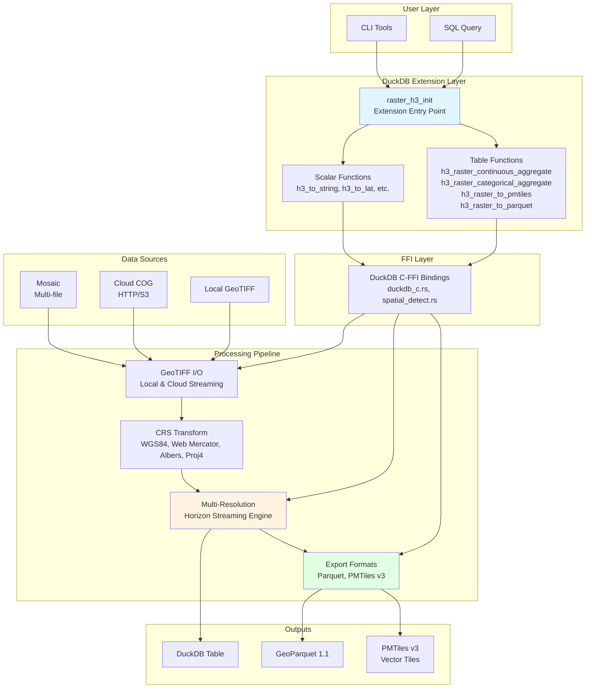
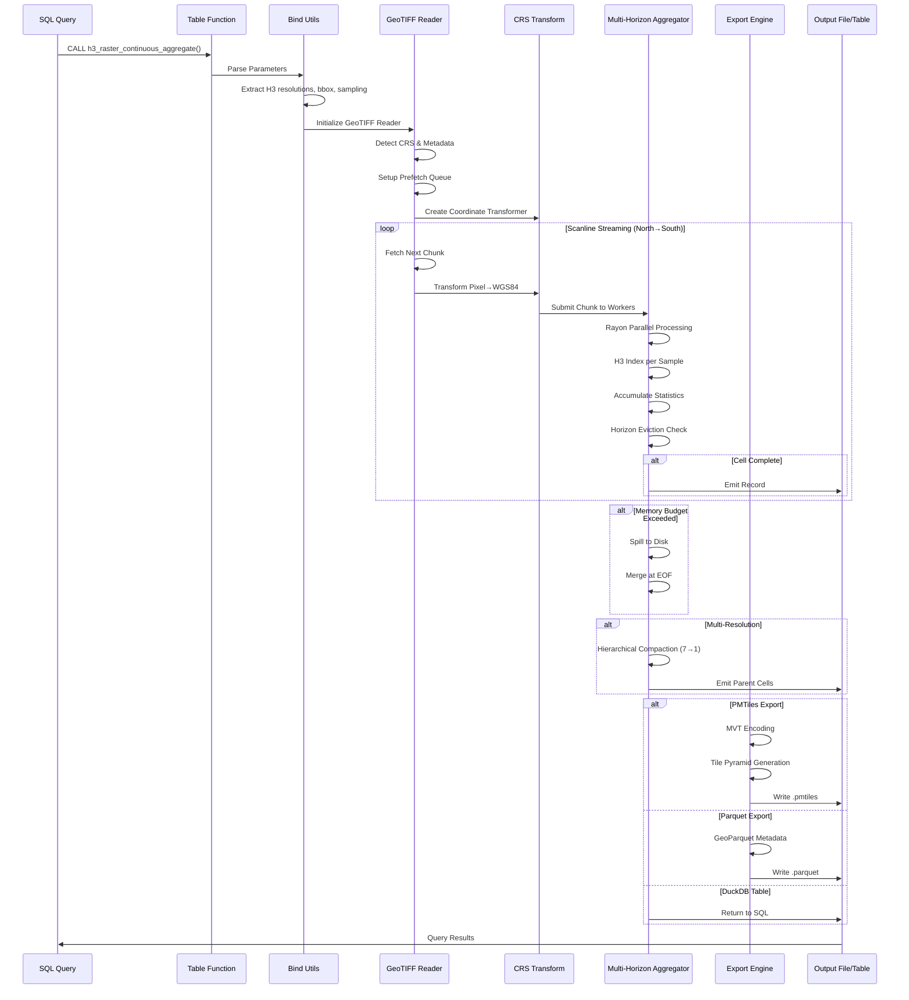
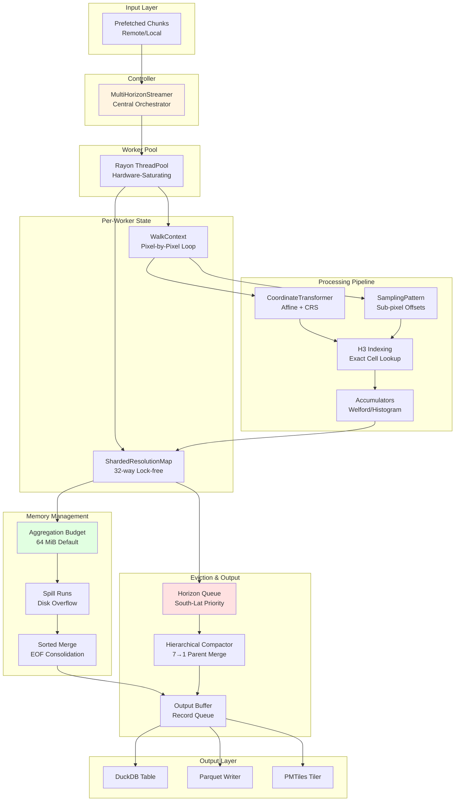
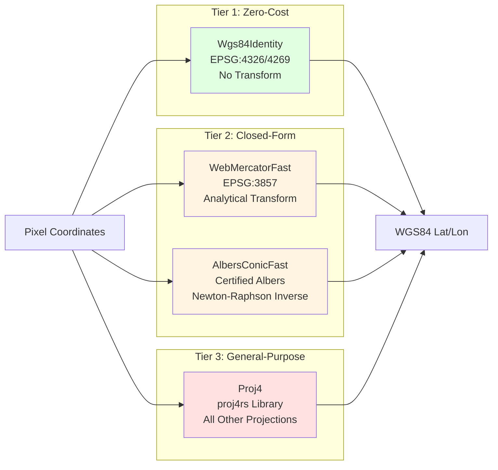
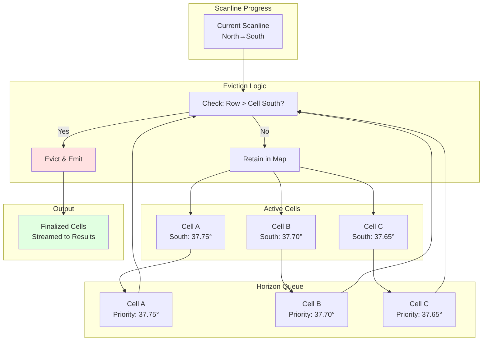
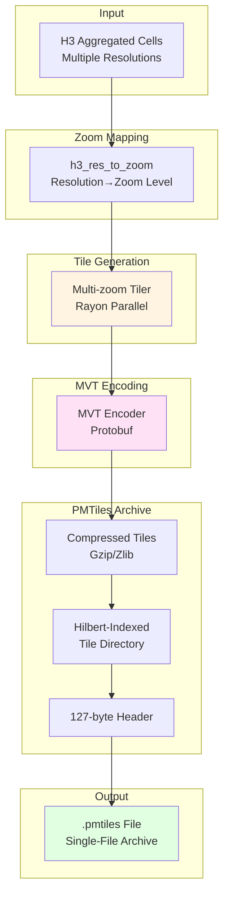

# raster_h3 Architecture Diagram

## High-Level System Architecture



## Detailed Module Architecture

```mermaid
graph TB
    subgraph "src/lib.rs - Extension Entry"
        Init[raster_h3_init<br/>Register Functions]
        CAPI[raster_h3_init_c_api<br/>v1.2+ C API]
        Version[raster_h3_version<br/>v0.0.1]
    end

    subgraph "src/functions/ - SQL Interface"
        TF[table_function.rs<br/>Continuous Aggregate]
        CTF[categorical_table_function.rs<br/>Categorical Aggregate]
        PTF[pmtiles_table_function.rs<br/>PMTiles Export]
        PQT[parquet_table_function.rs<br/>Parquet Export]
        SF[scalar.rs<br/>Helper Functions]
        BU[bind_utils/<br/>Parameter Binding]
    end

    subgraph "src/ffi/ - DuckDB Integration"
        DC[duckdb_c.rs<br/>C API Declarations]
        SD[spatial_detect.rs<br/>Version Detection]
    end

    subgraph "src/raster/ - GeoTIFF I/O"
        GT[geotiff.rs<br/>Streaming Reader]
        GTX[geotransform.rs<br/>Affine Transforms]
        MD[metadata.rs<br/>GeoKey Extraction]
        PR[predictor.rs<br/>TIFF Prediction]
        MOS[mosaic.rs<br/>Multi-file Mosaic]
        PF[prefetch.rs<br/>Local Prefetch Queue]
        RPF[remote_prefetch.rs<br/>Remote COG Prefetch]
        HR[http_range.rs<br/>HTTP Range Requests]
    end

    subgraph "src/crs/ - Projections"
        CRSMod[mod.rs<br/>CRS Detection]
        TRANS[transformer.rs<br/>3-Tier Pipeline<br/>Wgs84Identity<br/>WebMercatorFast<br/>AlbersConicFast<br/>Proj4 Fallback]
    end

    subgraph "src/aggregator/ - Statistical Engine"
        ACC[accumulator.rs<br/>Welford Mean/Variance]
        CAT[categorical.rs<br/>Class Histograms]
        QUANT[quantiles.rs<br/>DDSketch Quantiles]
        NOD[nodata.rs<br/>NoData Handling]
        REM[remap.rs<br/>Category Remapping]
        SAMP[sampling.rs<br/>Sub-pixel Patterns]
        SIMD[simd.rs<br/>Vectorized Spans]
        HS[h3_scanline.rs<br/>H3 Indexing]
        HST[horizon_streamer.rs<br/>Eviction Queue]
    end

    subgraph "src/aggregator/multi_horizon/ - Multi-Resolution Engine"
        CTRL[controller.rs<br/>Central Orchestrator]
        CFG[config.rs<br/>Query Configuration]
        LIFE[lifecycle.rs<br/>State Machine]
        SHARD[sharded_map.rs<br/>32-way Lock-free Maps]
        COMP[compaction.rs<br/>7→1 Hierarchical]
        CONT[continuous.rs<br/>Continuous Processing]
        CSTR[continuous_streamer.rs<br/>Continuous Streamer]
        CATM[categorical.rs<br/>Categorical Processing]
        CSTRM[categorical_streamer.rs<br/>Categorical Streamer]
        SPEC[spectral.rs<br/>NDVI/NDWI/NBR/EVI]
        WALK[walker.rs<br/>Pixel-by-Pixel Loop]
        COORD[coordinates.rs<br/>Coordinate Transforms]
        SPILL[spill.rs<br/>Disk Spilling]
    end

    subgraph "src/parquet/ - Parquet Export"
        PMOD[mod.rs]
        GM[geoparquet_metadata.rs<br/>OGC GeoParquet 1.1]
        PIPE[pipeline.rs<br/>Streaming Pipeline]
        WR[writer.rs<br/>Row Group Buffers]
    end

    subgraph "src/pmtiles/ - PMTiles Export"
        PMOD[mod.rs]
        PW[writer.rs<br/>PMTiles v3 Writer]
        MVT[mvt.rs<br/>MVT Encoding]
        PYR[pyramid.rs<br/>Tile Pyramid Math]
        FEAT[features.rs<br/>Feature Definitions]
        TIL[tiler.rs<br/>Multi-zoom Tiler]
    end

    subgraph "src/transcode/ - Format Conversion"
        TMOD[mod.rs]
        PT[parquet_tiler.rs<br/>Parquet→PMTiles]
    end

    subgraph "src/encoding/ - Serialization"
        EMOD[mod.rs]
        FH[fast_hex.rs<br/>Hex Formatting]
        WKB[wkb.rs<br/>WKB Geometry]
    end

    subgraph "src/error.rs"
        ERR[RasterH3Error<br/>Unified Error Types]
    end

    Init --> TF
    Init --> CTF
    Init --> PTF
    Init --> PQT
    Init --> SF

    TF --> BU
    CTF --> BU
    PTF --> BU
    PQT --> BU
    SF --> BU

    BU --> DC
    BU --> SD

    TF --> GT
    CTF --> GT
    PTF --> GT
    PQT --> GT

    GT --> GTX
    GT --> MD
    GT --> PR
    GT --> MOS
    GT --> PF
    GT --> RPF
    GT --> HR

    RPF --> HR

    MOS --> PF

    TF --> CRSMod
    CTF --> CRSMod
    PTF --> CRSMod
    PQT --> CRSMod

    CRSMod --> TRANS

    TF --> ACC
    TF --> CAT
    TF --> QUANT
    TF --> NOD
    TF --> REM
    TF --> SAMP
    TF --> SIMD
    TF --> HS
    TF --> HST

    CTF --> CAT
    CTF --> NOD
    CTF --> REM
    CTF --> SAMP
    CTF --> HST

    TF --> CTRL
    CTF --> CTRL
    PTF --> CTRL
    PQT --> CTRL

    CTRL --> CFG
    CTRL --> LIFE
    CTRL --> SHARD
    CTRL --> COMP
    CTRL --> SPILL
    CTRL --> CONT
    CTRL --> CSTR
    CTRL --> CATM
    CTRL --> CSTRM
    CTRL --> SPEC
    CTRL --> WALK
    CTRL --> COORD

    CONT --> WALK
    CSTR --> WALK
    CATM --> WALK
    CSTRM --> WALK

    WALK --> COORD
    WALK --> ACC
    WALK --> CAT
    WALK --> SAMP
    WALK --> SIMD

    PTF --> PW
    PTF --> MVT
    PTF --> PYR
    PTF --> FEAT
    PTF --> TIL

    PQT --> GM
    PQT --> PIPE
    PQT --> WR

    TIL --> PT

    TF --> FH
    TF --> WKB
    SF --> FH
    SF --> WKB

    style CTRL fill:#fff4e1
    style GT fill:#ffe1f5
    style TRANS fill:#e1f5ff
    style PW fill:#e1ffe1
```



## Data Flow Pipeline



## Multi-Resolution Horizon Streaming Engine



## CRS Transformation Three-Tier Pipeline



## Scanline Horizon Eviction



## PMTiles Multi-Resolution Pyramid



## Key Design Patterns

### 1. Streaming Scanline Architecture
- **Moving Scanner Front**: Processes raster row-by-row from North to South
- **Immediate Eviction**: Cells are finalized when scanline passes their southern boundary
- **Budgeted Aggregation**: Default 64 MiB accumulator budget with disk spilling
- **Constant Memory**: Only active accumulators in memory at any time

### 2. Multi-Resolution Streaming
- **Single Pass**: Aggregates all requested H3 resolutions in one raster scan
- **Hierarchical Compaction**: 7 child cells merge into 1 parent cell during eviction
- **Horizon-Based Eviction**: Prioritized by southernmost latitude per resolution
- **32-Way Sharding**: Lock-free hash maps eliminate thread contention

### 3. Three-Tier CRS Pipeline
- **Tier 1**: Zero-cost passthrough for WGS84 (EPSG:4326/4269)
- **Tier 2**: Closed-form analytical transforms for Web Mercator and certified Albers
- **Tier 3**: General-purpose proj4rs fallback for all other projections

### 4. Cloud-Native I/O
- **HTTP Range Prefetching**: Coalesces chunk ranges to cut round-trips 2×–5×
- **Mosaic Support**: Multi-file ingestion with overlap resolution
- **Memory-Mapped Files**: Zero-copy local file access via memmap2

### 5. Export Formats
- **PMTiles v3**: Single-file vector tile pyramids with Hilbert curve indexing
- **GeoParquet 1.1**: OGC-compliant with PROJJSON metadata
- **Zero Intermediate Files**: Direct transcoding from raster to final format

## Performance Optimizations

1. **SIMD Vectorization**: Span accumulation across native data types
2. **Row-Constant Hoisting**: CRS transform computed once per row, not per pixel
3. **Exact Per-Sample Indexing**: No coordinate drift accumulation
4. **Sub-Pixel Super-Sampling**: RGSS, Hex, Gaussian patterns for accuracy
5. **Work-Stealing Parallelism**: Rayon thread pool saturates all CPU cores
6. **Lock-Free Sharding**: 32-way partitioned maps eliminate contention
7. **Cache-Local Hot Path**: Tightly coupled walker/coordinates/accumulator loop

## Module Interdependencies

**Critical Path** (Hot Loop):
```
walker.rs → coordinates.rs → h3_scanline.rs → accumulator.rs → sharded_map.rs
```

**Supporting Path**:
```
geotiff.rs → prefetch.rs → metadata.rs → crs/transformer.rs → aggregator/multi_horizon/controller.rs
```

**Export Path**:
```
controller.rs → pmtiles/tiler.rs → pmtiles/mvt.rs → pmtiles/writer.rs
controller.rs → parquet/pipeline.rs → parquet/writer.rs
```

## Error Handling

All errors are unified in `src/error.rs`:
- `RasterH3Error` enum covers all recoverable error types
- I/O, TIFF decoding, metadata parsing, CRS detection, PROJ4, H3, invalid parameters
- DuckDB C-FFI errors, streaming failures
- Complete panic containment across all `extern "C"` boundaries
