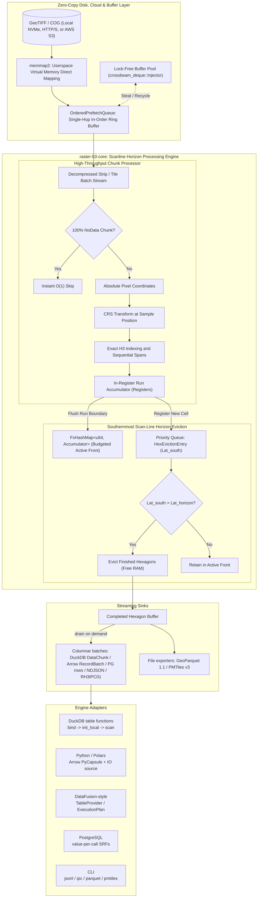

# raster_h3: High-Performance GeoTIFF-to-H3 Hexagonal Aggregation

[](https://opensource.org/licenses/MIT)
[](https://www.rust-lang.org)
[](docs/engines/duckdb.md)
[](docs/engines/python-polars.md)
[](docs/engines/postgresql.md)

A pure-Rust engine that aggregates multi-gigabyte geospatial rasters (GeoTIFF, Cloud-Optimized GeoTIFFs) into [Uber H3](https://h3geo.org/) hexagonal grid cells — and generates cloud-native **PMTiles v3** vector pyramids for instant web visualization. Aggregation uses a configurable memory budget with disk spilling. The same engine ships as a native DuckDB extension, DataFusion-style table providers, a Python/Polars package, a PostgreSQL extension and a command-line tool (see [Engines](#engines)).

The default aggregation budget is 64 MiB, not a whole-process RAM limit. Decoding,
prefetching, output buffers, and runtime overhead use additional memory. WGS84,
Web Mercator, and certified Albers chunks can evict completed cells early.
Arbitrary Proj4 chunks and Albers chunks that may contain the cone apex retain or
spill cells until the remaining input permits certified eviction or EOF is reached.
Mosaic workers retain at most 16 tile decoders each, using future chunk references
to avoid LRU thrashing on wide mosaics (see the [core engine notes](docs/engines/core.md#mosaic-decoder-cache)).

Supports **continuous** surfaces (elevation, temperature, NDVI, precipitation) and **categorical** classifications (land cover, zoning, soil types) with dedicated streaming engines.

Every valid sample is indexed at each requested H3 resolution. Projection row caches
support horizontal shear and profiling builds; Albers inverse constants are prepared
under an immutable borrow to avoid stale state after public source-field updates.
See the [core engine notes](docs/engines/core.md) for projection behavior.

Streamer `metrics()` exposes `StreamProfile::waves` (kernel dispatches),
`bridged_waves` (helper-thread dispatches from an external Rayon worker to a
dedicated pool), and `serial_waves` (dispatches run on the calling Rayon worker).
These counters are available without `stream-profile`; that feature adds per-sample
instrumentation. See [profiling and wave dispatch](docs/engines/core.md#profiling-and-wave-dispatch)
for the execution policy and hotspot harness.

| Output | Use Case | Available In |
| :--- | :--- | :--- |
| **H3 table / Arrow stream** | SQL analytics, JOINs, DataFrames | DuckDB, Python/Polars, PostgreSQL, DataFusion, CLI (NDJSON / `RH3IPC01`) |
| **PMTiles v3** | Web maps — zero servers, one file | DuckDB, Python, CLI |
| **GeoParquet 1.1** | GIS interchange (QGIS, GeoPandas, BigQuery) | DuckDB, Python, CLI |

---

## 📖 Table of Contents

- [Motivation & Project Goals](#motivation--project-goals)
- [How It Works](#how-it-works)
- [Engines](#engines)
- [Core Engineering Architecture](#core-engineering-architecture)
- [Architecture Diagram](#architecture-diagram)
- [Core Dependencies](#core-dependencies--architectural-contributions)
- [Troubleshooting & Common Pitfalls](#troubleshooting--common-pitfalls)
- [Building & Testing Locally](#building--testing-locally)
- [Deep Dives](#-deep-dives)
- [License](#license)

---

## Motivation & Project Goals

### The Problem: The Raster-Tabular Divide

Geospatial data exists in two incompatible formats:

1. **Tabular / Vector Data**: Points, polygons, GPS traces, and demographic records in relational databases (DuckDB, Snowflake, BigQuery, PostgreSQL).
2. **Raster Grids**: 2D pixel matrices in GeoTIFF files — satellite imagery, elevation models, climate grids, land cover maps.

Joining raster values (elevation, temperature, land cover) with business entities (customers, routes, parcels) has traditionally required complex, slow, memory-intensive ETL pipelines.

### The Solution: Uber H3 Discrete Global Grid System

The **Uber H3 Spatial Index** divides the Earth into a hierarchical grid of invariant hexagons across 16 resolution levels. Unlike square grids, hexagons have identical distances to all six neighbors and minimal area distortion across global latitudes.

Aggregating rasters into H3 solves four fundamental challenges of working with raw imagery:
* **Normalizes Disparate Resolutions & Projections**: Rasters arrive with differing pixel sizes (10m Sentinel, 30m Landsat, 1km climate grids) and incompatible local projections. H3 maps them all into a single, standardized global grid without manual grid resampling.
* **Drastic 50×–100× Data Reduction**: An H3 Resolution 8 cell aggregates roughly 800 thirty-meter pixels into a single summary row, shrinking a multi-gigabyte raster by orders of magnitude on disk.
* **Preserves Rich Surface Distributions**: Rather than losing nuance to a simple average, the engine captures the full distribution per cell—including mean, variance/ruggedness, and min/max for continuous terrain, plus class purity and Shannon entropy (landscape fragmentation) for categorical maps.
* **Unlocks Relational Joins**: Every hexagon is addressed by a compact 64-bit integer (`UBIGINT` / `UInt64` / hex string). Once pixels become H3 cells, rigid 2D raster matrices become standard relational tables joinable directly with tabular business data: `JOIN ON r.h3_index = v.h3_index`.

For more details on the grid system and its mathematical design, see the [official H3 documentation](https://h3geo.org/docs/) and the [Uber engineering blog](https://www.uber.com/blog/h3/).

### Raster Meets Table: A Worked Example

A city planning department has two datasets:

1. **A land cover raster** — a 30-meter NLCD GeoTIFF classifying every pixel as forest, grassland, impervious surface, water, etc.
2. **A census demographics table** — 4,200 census tract boundary polygons (GeoJSON / GeoParquet) with total population and median income.

**The question**: *Which low-income, densely populated neighborhoods have the least tree canopy coverage?*

Without a shared spatial index, answering this requires an expensive GIS overlay: reprojecting rasters, clipping polygons, rasterizing geometries, and managing gigabytes of temporary scratch files. With `raster_h3`, both datasets meet on the H3 hexagonal grid. The same analysis in two engines:

#### DuckDB (SQL)

```sql
-- Reading and polyfilling the tracts uses DuckDB's spatial extension alongside raster_h3:
-- INSTALL spatial; LOAD spatial;

-- 1. Aggregate the 30m land cover raster into H3 hexagons (with budgeted aggregation)
CREATE TABLE canopy_h3 AS
SELECT h3_index, majority_class, majority_fraction AS canopy_purity
FROM h3_raster_categorical_aggregate(
    'nlcd_landcover_2021.tif', resolution := 8
);

-- 2. Polyfill vector census tracts into H3 cells & compute population density
-- 'covers' returns every hexagon that overlaps the tract, plus the enclosing hexagon for tracts
-- smaller than one cell, so no tract drops out (border hexagons count for both neighbours).

CREATE TABLE census_tracts_h3 AS
SELECT 
    tract_name,
    median_income,
    round(total_population / (ST_Area_Spheroid(ST_FlipCoordinates(geom)) / 1000000.0), 0) 
        AS pop_density_per_sqkm,
    unnest(h3_polygon_to_cells(ST_AsWKB(geom), 8, 'covers'))
        AS h3_index
FROM ST_Read('census_tracts.geojson');

-- 3. JOIN raster results with census tracts on the shared H3 index
SELECT
    c.tract_name,
    c.median_income,
    c.pop_density_per_sqkm,
    t.majority_class AS dominant_landcover,
    t.canopy_purity
FROM census_tracts_h3 AS c
JOIN canopy_h3 AS t 
  ON c.h3_index = t.h3_index
WHERE t.majority_class = 41          -- Deciduous forest (NLCD code)
  AND t.canopy_purity  < 0.30        -- Less than 30% tree canopy
  AND c.median_income  < 45000       -- Low-income tracts
  AND c.pop_density_per_sqkm > 3000  -- Densely populated urban neighborhoods
ORDER BY t.canopy_purity ASC;
```

#### Python & Polars

```python
# pip install "./crates/raster-h3-python[polars]" geopandas
import geopandas as gpd
import polars as pl
import raster_h3

# 1. Aggregate the 30m land cover raster into H3 hexagons (a lazy Polars scan)
canopy_h3 = raster_h3.scan_raster_h3(
    "nlcd_landcover_2021.tif", 8, categorical=True,
    columns=["h3_index", "majority_class", "majority_fraction"],
).rename({"majority_fraction": "canopy_purity"})

# 2. Polyfill vector census tracts into H3 cells & compute population density
#    ("covers" returns every hexagon that overlaps the tract, plus the enclosing hexagon for
#    tracts smaller than one cell, so no tract drops out; border hexagons count for both neighbours)
tracts = gpd.read_file("census_tracts.geojson").to_crs(4326)
area_sqkm = tracts.to_crs(tracts.estimate_utm_crs()).area / 1e6
census_tracts_h3 = pl.DataFrame({
    "tract_name": tracts["tract_name"].tolist(),
    "median_income": tracts["median_income"].tolist(),
    "pop_density_per_sqkm": (tracts["total_population"] / area_sqkm).round(0).tolist(),
    "h3_index": [raster_h3.h3_polygon_to_cells(g.wkb, 8, "covers") for g in tracts.geometry],
}).explode("h3_index").with_columns(pl.col("h3_index").cast(pl.UInt64))

# 3. JOIN raster results with census tracts on the shared H3 index
result = (
    census_tracts_h3.lazy()
    .join(canopy_h3, on="h3_index")
    .filter(
        (pl.col("majority_class") == 41)            # Deciduous forest (NLCD code)
        & (pl.col("canopy_purity") < 0.30)          # Less than 30% tree canopy
        & (pl.col("median_income") < 45_000)        # Low-income tracts
        & (pl.col("pop_density_per_sqkm") > 3_000)  # Densely populated neighborhoods
    )
    .select("tract_name", "median_income", "pop_density_per_sqkm",
            pl.col("majority_class").alias("dominant_landcover"), "canopy_purity")
    .sort("canopy_purity")
    .collect()
)
```

Python scans reject malformed `resolutions`, `format` and `bbox` with `RuntimeError`
instead of silently ignoring them or using defaults. Parquet and PMTiles exports
also reject invalid resolutions; every resolution must be between 0 and 15. See the
[Python scan parameters](docs/engines/python-polars.md#scan-parameters) for details.

> No GDAL. No intermediate files. The raster *becomes* a queryable table source — a SQL table function in DuckDB, a `LazyFrame` in Polars.

### Why Intermediate H3 Aggregations Change Everything

Materializing both raster and vector datasets into intermediate H3 tables (or Parquet files) provides fundamental architectural advantages over traditional GIS workflows:

#### 1. Benefits for Vector Datasets
* **Polyfill Once, Eliminate Geometry Math**: Administrative boundaries (census tracts, voting precincts, parcel lots) often contain thousands of vertices. Evaluating spatial containment (`ST_Contains`, `ST_Intersects`) across millions of records is computationally brutal. Polyfilling vector polygons into H3 cells once eliminates all downstream polygonal math.
* **Decoupled Update Cycles**: Demographic tables, property boundaries, and customer records update frequently (daily, monthly, or annually), while foundational rasters (elevation DEMs, land cover) change rarely. Pre-indexing vectors into H3 lets you incorporate updated vector tables with a 50ms hash join—without re-reading a 50 GB raster.
* **Standardizing Irregular Shapes (MAUP Mitigation)**: Census tracts and zip codes vary radically in area—a rural tract can be 1,000× larger than an urban one, severely distorting statistical comparisons. Polyfilling vectors into uniform H3 hexagons discretizes irregular boundaries into equal-area spatial units.

#### 2. Benefits for Raster Ingestion
* **Scan Once, Query Everywhere**: Decompressing and processing an 8–50 GB GeoTIFF (billions of pixels) is an intensive operation you only want to do once. Once aggregated into `canopy_h3` or exported to Parquet, downstream analyses query in milliseconds without touching raw raster pixels again.
* **Drastic Storage Reduction**: A multi-gigabyte raster compresses into a compact, columnar H3 table that is 50×–100× smaller on disk. You can easily version-control it, store it in your cloud data lake (S3/R2), or query it from DuckDB, Polars, PostgreSQL, Snowflake, or BigQuery.

#### 3. Benefits for Spatial Joining & Visualization
* **$O(1)$ Hash Joins vs $O(N \times M)$ Geometry Math**: Converting both raster pixels and vector polygons to 64-bit integer H3 cells replaces expensive topological intersection algorithms with hardware-speed **integer equality hash joins** (`JOIN ON c.h3_index = t.h3_index`).
* **Universal Lingua Franca**: Any number of disparate rasters (elevation, temperature, canopy) and vector layers (demographics, parcels, sensor points) can be joined together in a single multi-way query—eliminating projection mismatches, resolution differences, and resampling errors.
* **Direct PMTiles from Vector Parquet**: Intermediate H3 vector tables stored in Parquet can be transcoded directly into multi-zoom web map pyramids (DuckDB `h3_parquet_to_pmtiles`) without Tippecanoe, GDAL, or GeoJSON scratch files.

### From Query to Web Map in One Step

`raster_h3` can export results directly to a **PMTiles v3** single-file vector tile archive — a multi-resolution pyramid ready for MapLibre, Kepler.gl, or Felt with zero intermediate files and zero tile servers:

```bash
raster-h3-cli pmtiles nlcd_landcover_2021.tif -c -r 5,6,7,8 -o landcover_canopy.pmtiles
```

```python
raster_h3.raster_to_pmtiles("nlcd_landcover_2021.tif", "landcover_canopy.pmtiles", [5, 6, 7, 8], categorical=True)
```

```sql
-- DuckDB
SELECT * FROM h3_raster_to_pmtiles(
    'nlcd_landcover_2021.tif', 'landcover_canopy.pmtiles',
    min_resolution := 5, max_resolution := 8, categorical := true
);
```

Upload `landcover_canopy.pmtiles` to S3, R2, or GitHub Pages, open it in MapLibre GL JS, and zoom from state level to city block.

A web map needs tiles at every zoom level — from hemispheric overview down to street-level detail. `raster_h3` builds this entire multi-resolution pyramid in a single pass over the raster, aggregating pixels simultaneously across all requested H3 resolutions. See [PMTiles & Multi-Resolution](docs/pmtiles.md) for the full deep dive.

### Design Principles

| Principle | What It Means |
| :--- | :--- |
| **Pure Rust, Zero C++ Dependencies** | No GDAL, PROJ or Python runtime; each engine ships as one native library or binary |
| **One Core, Many Engines** | DuckDB, DataFusion, Python/Polars, PostgreSQL and the CLI all drive the same streamers and return the same cells |
| **Budgeted aggregation** | Configurable accumulator budget with disk spilling; total RAM also includes decoding and prefetch buffers |
| **Hardware-Saturating Throughput** | Work-stealing parallelism across all CPU cores |
| **Native PMTiles v3 Export** | Single-file web maps — zero Tippecanoe, zero tile servers |
| **Native GeoParquet 1.1 Export** | Stack-allocated WKB polygons with PROJJSON metadata |
| **Cloud-Native Streaming** | HTTP/S3 COG range prefetching — no local copies needed |
| **Sub-Pixel Super-Sampling** | RGSS, Hex, Gaussian, 8-Rooks boundary anti-aliasing |

---

## How It Works

Traditional tools struggle with large rasters. Here is how `raster_h3` solves each bottleneck:

| Step | Traditional Approach | raster_h3 Approach |
| :--- | :--- | :--- |
| **Memory** | Load entire raster into RAM | Budget active accumulators and spill to disk |
| **Projection** | Recalculate spherical math per pixel | Row-constant hoisting: 1 transform per row |
| **H3 Lookup** | Recompute cell ID per pixel | Exact per-sample indexing with run accumulation |
| **Eviction** | Hold all results until file completion | Evict finished hexagons immediately via horizon scan |
| **Web Tiling** | C++ Tippecanoe + scratch files + tile servers | Generate `.pmtiles` archives in 1 step |

### The Moving Scanner Front (Constant Memory)

`raster_h3` streams the raster like a document scanner — one thin row at a time from North to South:
- **Immediate Eviction**: When a scanline passes a hexagon's southernmost boundary, that cell is finalized and streamed directly into query results.
- **Aggregation memory budget**: The default is 64 MiB for aggregation. This is not a total-process RAM limit; decoded chunks, prefetch buffers, output buffers, and other overhead also consume memory.

### Direct Web-Ready Map Tiles

Generates single-file **PMTiles v3** vector pyramids directly from DuckDB SQL, Python or the CLI:
- **Zero Intermediate Tooling**: Eliminates C++ Tippecanoe, GeoJSON scratch files, and dedicated tile server infrastructure.
- **Serverless Map Delivery**: Upload the `.pmtiles` archive directly to Amazon S3, Cloudflare R2, or GitHub Pages and render with zero backend infrastructure.

### Exact Coordinates and Sequential Spans

Pixel centers and subpixel samples use absolute raster coordinates followed by
CRS transformation. Span discovery uses the same calculation as ordinary pixel
assignment, avoiding accumulated coordinate drift. Each candidate is indexed
with H3; contiguous equal-cell runs share accumulation work. Supersampling evaluates each sample once and combines same-cell weights per pixel,
replaying stored assignments when samples split across cells.

### In-Engine Streaming

Aggregated cells stream into the host engine as they complete — DuckDB `DataChunk`s,
Arrow `RecordBatch`es for DataFusion and Polars, PostgreSQL rows, or NDJSON / `RH3IPC01` on
stdout — so queries, joins and exports start before the raster is fully read. Every engine
pulls on demand, so a `LIMIT` stops aggregation early. When active accumulators exceed
their budget, temporary spill files hold partial results for merging; the core streamers
report the runs written in total (`spill_run_count()`) and per resolution
(`spill_run_counts()`). Projected inputs without certified bounds may defer output until EOF.

Categorical wide output has one row per cell; long output has one row per
`(cell, category)`. In the core batch reader, `batch_size` and `limit` count these
output rows, not cells in long format. Core and DuckDB long readers expand one
cell at a time using the public `CategoricalLongCursor`, keeping pending categories
bounded by the largest single cell rather than a batch of cells. A cell can span
multiple batches, and a limit can stop mid-cell; entropy is computed only when an
entropy column is projected. See the [core batch-reader contract](docs/engines/core.md#batch-readers).

---

## Engines

The repository is a Cargo workspace: `raster-h3-core` does all decoding, reprojection,
aggregation and export, and each engine crate is a thin adapter over it, so every engine
returns the same cells and statistics for the same input.

| Engine | Crate | Get it | Docs |
| :--- | :--- | :--- | :--- |
| **DuckDB** | `raster-h3-duckdb` | Pre-built `.duckdb_extension` from [Releases](https://github.com/dmuldrew/raster_h3/releases), Docker, or `cargo build --release` → `libraster_h3.{so,dylib,dll}` | [DuckDB deep dive](docs/engines/duckdb.md) · [SQL API Reference](docs/api-reference.md) |
| **Python / Polars** | `raster-h3-python` | `pip install ./crates/raster-h3-python` (wheels are built in CI; not yet on PyPI) | [Python & Polars](docs/engines/python-polars.md) |
| **PostgreSQL 13–18** | `raster-h3-pg` | `cargo build -p raster-h3-pg --features pg-extension` | [PostgreSQL](docs/engines/postgresql.md) |
| **DataFusion-style Rust API** | `raster-h3-datafusion` | Cargo dependency | [DataFusion](docs/engines/datafusion.md) |
| **CLI** | `raster-h3-cli` | `cargo build --release -p raster-h3-cli` (also in the Python wheel) | [CLI](docs/engines/cli.md) |
| **Rust library** | `raster-h3-core` | Cargo dependency | [Core Engine](docs/engines/core.md) |

Feature coverage differs per engine: DuckDB exposes every parameter (sampling, bands,
spectral formulas, quantiles, remapping, budgets), DataFusion exposes most of them through
builders, and PostgreSQL, Python and the CLI expose the common subset (resolutions, CRS,
NoData, bbox, categorical layout). The [Engines Overview](docs/engines/README.md) has the
full capability matrix, shared output schemas, a side-by-side cheat sheet and the
cross-engine parity tests. Each engine deep dive covers install, recipes (basic and
advanced scans, scalar helpers, joins, exports, remote COGs, mosaics, categorical queries),
internals and troubleshooting.

### Quick Start

**DuckDB**

```sql
LOAD 'target/release/libraster_h3.dylib'; -- or INSTALL from a release, see the DuckDB deep dive
SELECT h3_hex, mean, count
FROM h3_raster_continuous_aggregate('dem.tif', resolution := 8)
LIMIT 5;

-- Polyfill a WKB polygon: list of UBIGINT cells; containment defaults to 'contains_centroid'
SELECT h3_polygon_to_cells(ST_AsWKB(geom), 8, 'covers') AS cells FROM areas;
```

See [`h3_polygon_to_cells`](docs/api-reference.md#h3_polygon_to_cells) for the containment modes
(also available in Python as `raster_h3.h3_polygon_to_cells`).

**Python / Polars**

```python
import polars as pl
import raster_h3

df = (raster_h3.scan_raster_h3("dem.tif", 8)
        .filter(pl.col("count") > 10)
        .select("h3_hex", "mean", "count")
        .collect())
```

**PostgreSQL**

```sql
CREATE EXTENSION raster_h3;
SELECT h3_hex, mean, count FROM h3_raster_continuous_aggregate('/data/dem.tif', 8) LIMIT 5;
```

**CLI**

```bash
raster-h3-cli jsonl dem.tif -r 8 --columns h3_hex,mean,count --limit 5
raster-h3-cli parquet dem.tif -r 7,8 -o dem_h3.parquet
```

**DataFusion-style Rust API**

```rust
use raster_h3_datafusion::{FilterPredicate, RasterH3SessionCatalog, TableProvider};

let ctx = RasterH3SessionCatalog::new();
let provider = ctx.h3_raster_continuous_aggregate("dem.tif", vec![8])?;
let plan = provider.scan(Some(&[0, 2]), &[FilterPredicate::MinCount(10.0)], Some(1000))?;
for batch in plan.execute()? { /* RecordBatch with h3_index, mean */ }
```

**Rust library**

```rust
use raster_h3_core::aggregator::multi_horizon::MultiResolutionConfig;
use raster_h3_core::columnar::ContinuousBatchReader;
use raster_h3_core::raster::mosaic::resolve_raster_sources;

let paths = resolve_raster_sources("dem.tif")?;
let reader = ContinuousBatchReader::open(&paths, &MultiResolutionConfig::new(vec![8]), None, 2048, None)?;
```

Continuous readers build per-cell quantile sketches only when a configured quantile
column is projected (or the full schema is requested). The schema is unchanged;
`ContinuousBatchReader::tracks_quantiles()` reports the decision, and
`columnar::quantiles_projected()` exposes the projection rule.
`aggregator::multi_horizon::QuantilePlan` evaluates projected percentiles and IQR
with one sketch sweep per cell, sharing repeated probabilities. See the
[core engine guide](docs/engines/core.md#batched-quantile-evaluation) for details.

---

## Core Engineering Architecture

`raster_h3` achieves near-hardware-limit throughput through these architectural principles, shared by every engine:

| # | Engineering Pillar | Impact |
| :---: | :--- | :--- |
| 1 | **Southernmost Scan-Line Horizon Eviction** | Early eviction where certified; disk spilling otherwise |
| 2 | **Sequential H3 Spans** | Exact indexing with shared accumulation for consecutive equal-cell pixels |
| 3 | **CRS Transformation** | Identity, analytical, or Proj4 transformation at sample positions |
| 4 | **Absolute Pixel Coordinates** | One affine coordinate formula for walking, spans, and samples |
| 5 | **In-Register Run Accumulation** | ~98% fewer hash table lookups |
| 6 | **Branchless Hardware Min/Max** | Zero branch misprediction penalties (`minsd`/`maxsd`) |
| 7 | **Zero-Copy `memmap2` & Async Prefetching** | Direct virtual memory mapping with background decompression |
| 8 | **Zero-Allocation Hex Formatting** | Stack-based 16-byte LUT for H3 index formatting |
| 9 | **ROI Bounding Box Chunk Pruning** | Non-intersecting chunks skipped before decompression, for CRSs with certified bounds, including EPSG:3413/3031 polar grids ([details](docs/crs-and-projection.md#bounding-boxes-and-pruning)) |
| 10 | **Work-Stealing Parallelism** | Rayon kernel windows in every engine; DuckDB additionally scans with one `init_local` state per thread |
| 11 | **Lock-Free Buffer Pool** | Zero-allocation buffer recycling via `crossbeam_deque::Injector` |
| 12 | **Single-Hop In-Order Prefetcher** | Direct worker-to-ring-buffer queue, zero context switches |
| 13 | **Cloud-Native COG & Mosaic Ingestion** | Async HTTP/S3 range prefetching with Voronoi cutline blending |
| 14 | **Native OGC GeoParquet 1.1 Exporter** | GIS-valid WKB cell polygons (dateline cells split, polar caps) with embedded PROJJSON metadata |

> 📖 **Detailed explanations** of each architectural pillar — See [docs/engineering.md](docs/engineering.md)  
> 🗺️ **Source Module Architecture** — File-by-file breakdown of crate internals mapped to these principles: [docs/module-architecture.md](docs/module-architecture.md)

---

## Architecture Diagram



> 🗺️ **Looking for source file responsibilities?** See the complete [Source Module Architecture](docs/module-architecture.md) for a guide to every file in the workspace.

---

## Core Dependencies & Architectural Contributions

Version requirements live in [Cargo.toml](Cargo.toml); resolved versions live in [Cargo.lock](Cargo.lock).

| Dependency | Purpose | Contribution |
| :--- | :--- | :--- |
| [`h3o`](https://crates.io/crates/h3o) | Pure-Rust H3 Engine | 100% Rust H3 DGGS — no C/C++ FFI overhead |
| [`memmap2`](https://crates.io/crates/memmap2) | Virtual Memory I/O | Zero-copy GeoTIFF mapping with sequential readahead |
| [`crossbeam-deque`](https://crates.io/crates/crossbeam-deque) | Lock-Free Buffer Pool | Concurrent work-stealing buffer recycling |
| [`libdeflater`](https://crates.io/crates/libdeflater) | SIMD Deflate | Hardware-accelerated decompression (AVX-512, NEON) |
| [`weezl`](https://crates.io/crates/weezl) | LZW Decoder | Fast streaming LZW for legacy GeoTIFFs |
| [`parquet`](https://crates.io/crates/parquet) | GeoParquet Engine | Streaming row-group writer with OGC GeoParquet 1.1 |
| [`tiff`](https://crates.io/crates/tiff) | GeoTIFF Decoder | Baseline TIFF, tiled TIFF, and BigTIFF support |
| [`proj4rs`](https://crates.io/crates/proj4rs) | Geodetic Reprojection | Pure-Rust PROJ.4 (UTM, Lambert, Albers → WGS84) |
| [`rustc-hash`](https://crates.io/crates/rustc-hash) | Fast Hasher | Maintained Fx hashing for numeric H3 cell keys (not a cryptographic hasher) |
| [`rayon`](https://crates.io/crates/rayon) | Work-Stealing Parallelism | Lock-free data parallelism across CPU cores |
| [`flate2`](https://crates.io/crates/flate2) | Tile Compression | Gzip for MVT payloads and PMTiles directories |
| [`thiserror`](https://crates.io/crates/thiserror) & [`serde`](https://crates.io/crates/serde) | Error & Serialization | Typed error propagation and JSON formatting |

---

## Troubleshooting & Common Pitfalls

Decoded TIFF chunks with invalid dimensions, overflowed layouts, or truncated source/destination
buffers return an error before sample unpacking rather than indexing unchecked layouts.

These apply to every engine. Engine-specific issues (DuckDB unsigned extensions, the
Python native library path, PostgreSQL privileges and version mismatches) are in each
deep dive's troubleshooting section: [DuckDB](docs/engines/duckdb.md#troubleshooting),
[Python](docs/engines/python-polars.md#troubleshooting),
[PostgreSQL](docs/engines/postgresql.md#troubleshooting).

### Missing or Non-Standard CRS

If a GeoTIFF lacks embedded projection tags, `raster_h3` halts with:
```
CRS transformation error: No CRS detected in raster metadata. A CRS must be specified explicitly.
```

This prevents silent spatial corruption — meter-based coordinates treated as degrees would place hexagons in the wrong location. Specify the CRS explicitly:

| Engine | Override |
| :--- | :--- |
| DuckDB | `h3_raster_continuous_aggregate('grid.tif', resolution := 8, source_crs := 'EPSG:32610')` |
| Python | `raster_h3.scan_raster_h3("grid.tif", 8, crs="EPSG:32610")` |
| PostgreSQL | `h3_raster_continuous_aggregate('/data/grid.tif', 8, source_crs => 'EPSG:32610')` |
| CLI | `raster-h3-cli jsonl grid.tif -r 8 --crs EPSG:32610` |
| DataFusion | `ContinuousRasterTableProvider::try_new("grid.tif", vec![8])?.with_crs("EPSG:32610")` |

Valid pixels whose transform fails or lands outside the valid latitude/longitude range are dropped rather than aborting the stream; they are counted by `transform_failures()` (core streamers and batch readers), and the CLI prints a warning to stderr. See [transform-failure diagnostics](docs/engines/core.md#transform-failure-diagnostics).

For supported projection families, see [Supported CRS](docs/crs-and-projection.md). Helmert datum shifts (`+towgs84`, and built-in national grids such as `EPSG:27700` and `EPSG:28992`) are applied; grid-based shifts such as NAD27 are rejected (see [Datum Shifts](docs/crs-and-projection.md#datum-shifts)). To convert your dataset into zero-trig native WGS84 for maximum throughput, see [Optimal Raster Format & Ingestion Speed](docs/optimal-raster-format.md).

### Scaled Values (GDAL Scale/Offset) and Alpha

Bands that carry GDAL `SCALE`/`OFFSET` metadata (packed reflectance, temperatures) are
aggregated as physical values, `stored * scale + offset`, including quantiles and spectral
indices. NoData is matched on the stored value, categorical classes are never scaled, and
pixels whose TIFF alpha sample is `0` are excluded. Invalid scale/offset metadata (including
a zero or non-finite scale) is rejected when the file is opened, even in raw-value mode.
To aggregate stored values from files with valid metadata instead:

| Engine | Opt-out |
| :--- | :--- |
| DuckDB | `h3_raster_continuous_aggregate('lst.tif', resolution := 8, scale_offset := false)` |
| CLI | `raster-h3-cli jsonl lst.tif -r 8 --raw-values` |
| DataFusion | `ContinuousRasterTableProvider::try_new("lst.tif", vec![8])?.with_scale_offset(false)` |

Python and PostgreSQL always calibrate. See [Band calibration and validity](docs/api-reference.md#band-calibration-and-validity).

### Antimeridian Crossing

For datasets spanning ±180° longitude, `raster_h3` automatically wraps coordinates. For ROI bounding box filters across the antimeridian, split into two queries (e.g., `[170.0, 180.0]` and `[-180.0, -170.0]`).

### BigTIFF & Codec Compatibility

Natively decodes TIFF 6.0 and BigTIFF (>4 GB) with: Raw, Deflate (Zlib), LZW, PackBits compression and `Float32/64`, `UInt8/16/32`, `Int8/16/32` pixel types. For unsupported codecs (JPEG2000, WebP, LERC), convert first:

```bash
gdal_translate -co COMPRESS=DEFLATE input.tif output.tif
```

For maximum ingestion throughput (up to 6× faster) and optimal L2 cache residency, see the recommended GDAL conversion recipes in the [Optimal Raster Format Deep Dive](docs/optimal-raster-format.md).

### Container Memory Mapping

`raster_h3` uses `memmap2` for virtual memory mapping. Ensure container runtimes allow `mmap` system calls.

---

## Building & Testing Locally

### Prerequisites
- [Rust](https://rustup.rs/) (Edition 2021+, stable toolchain)
- Optional, for the engine tests that use them: [DuckDB CLI](https://duckdb.org/) 1.0.0+ on `PATH`, `python3` (with Polars/PyArrow for the Python tests), Docker (real PostgreSQL servers)

### Build
```bash
cargo build --release
```
Outputs: `target/release/libraster_h3.dylib` (macOS) / `.so` (Linux) / `.dll` (Windows) — the DuckDB extension — and the `raster-h3` CLI.

To build the packaged `build/release/raster_h3.duckdb_extension` the way the DuckDB community-extensions CI does, run `git submodule update --init && make configure && make release` ([Community Extension Build](docs/engines/duckdb.md#community-extension-build)).

Other workspace members build individually:

```bash
cargo build --release -p raster-h3-cli                         # raster-h3-cli executable
cargo build --release -p raster-h3-python                      # libraster_h3_python (Python ctypes library)
cargo build --release -p raster-h3-pg --features pg-extension  # PostgreSQL module (needs pg_config or RASTER_H3_PG_MAJOR)
```

| Crate | Path |
| :--- | :--- |
| `raster-h3-core` | [`crates/raster-h3-core`](crates/raster-h3-core) |
| `raster-h3-duckdb` | [`crates/raster-h3-duckdb`](crates/raster-h3-duckdb) |
| `raster-h3-datafusion` | [`crates/raster-h3-datafusion`](crates/raster-h3-datafusion) |
| `raster-h3-python` | [`crates/raster-h3-python`](crates/raster-h3-python) |
| `raster-h3-pg` | [`crates/raster-h3-pg`](crates/raster-h3-pg) |
| `raster-h3-cli` | [`crates/raster-h3-cli`](crates/raster-h3-cli) |

### Test

See [Test Coverage](docs/testing.md) for what each suite checks and which tests are gated.

```bash
cargo test --release --workspace

# Cross-engine parity (core, CLI, DataFusion, Python, PostgreSQL in-process, DuckDB if on PATH)
cargo test -p raster_h3 --test it multi_engine_e2e

# Real PostgreSQL servers in Docker (RASTER_H3_PG_VERSIONS=14,16,18 to pick majors)
cargo test -p raster_h3 --test it pg_extension_e2e -- --ignored --nocapture

# Or in Docker
docker run --rm -v "$(pwd)":/build -w /build rust:bookworm cargo test --release --workspace
```

### Profilers & Examples
```bash
cargo run --release --example benchmark_bottleneck path/to/raster.tif
cargo run --release --example benchmark_scaling
cargo run --release --example raster_to_pmtiles -- --input data/sample_sf.tif --output data/sample_sf.pmtiles
```

---

## 📖 Deep Dives

Topic guides that apply to every engine. Engine-specific documentation is listed under
[Engines](#engines).

| Document | What It Covers |
| :--- | :--- |
| [Engineering Architecture](docs/engineering.md) | Streaming, memory budgets, disk spilling, and throughput |
| [Module Architecture](docs/module-architecture.md) | File-by-file source code map with GitHub links |
| [PMTiles & Multi-Resolution](docs/pmtiles.md) | Multi-resolution pyramids, zoom mapping, zero-server web maps |
| [Optimal Raster Formats](docs/optimal-raster-format.md) | Why tiled WGS84 COGs are 4.5–6× faster, GDAL recipes |
| [Super-Sampling](docs/super-sampling.md) | RGSS, Hex, Gaussian boundary anti-aliasing presets |
| [CRS & Projections](docs/crs-and-projection.md) | Supported projections, detection, 3-tier transform hierarchy |
| [Architecture Comparison](docs/architecture-comparison.md) | Benchmarks vs Python/PostGIS/GDAL, environment trade-offs |
| [Test Coverage](docs/testing.md) | Every test suite grouped by category (geodetic, threading, eviction, codecs, engines…), gated tests, CI coverage |

---

## License

This project is licensed under the [MIT License](LICENSE).
