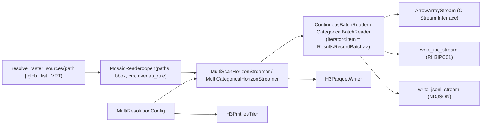

# Core Engine Deep Dive: `raster-h3-core`

[← Engines Overview](README.md) · [← Back to README](../../README.md)

`raster-h3-core` ([`crates/raster-h3-core`](../../crates/raster-h3-core)) is the
engine-neutral library every adapter builds on. It has no dependency on DuckDB,
PostgreSQL, Python or DataFusion. It holds the modules that used to live in the root
`src/` (raster I/O, CRS, aggregator, encoding, Parquet, PMTiles, transcode), plus two
modules added for the multi-engine split:

- [`columnar`](../../crates/raster-h3-core/src/columnar/mod.rs): an Arrow-shaped
  `RecordBatch` model, streaming batch readers, the Arrow C Data / C Stream interface,
  and the `RH3IPC01` / NDJSON serializers.
- [`scalar_ops`](../../crates/raster-h3-core/src/scalar_ops.rs): the H3 scalar helpers
  and parameter parsers that all adapters share.

See [Module Architecture](../module-architecture.md) for a file-by-file map of the
aggregation internals and [Engineering Architecture](../engineering.md) for streaming,
eviction and memory budgets.

```toml
[dependencies]
raster-h3-core = { path = "crates/raster-h3-core" }
```

## Pipeline

The sample-unpacking boundary checks TIFF chunk dimensions, arithmetic overflow, source
length and destination capacity. Invalid or truncated decoded chunks return `InvalidMetadata`
before indexing/copying, including the floating-point predictor path.



Every adapter follows the same steps:

1. Build a `MultiResolutionConfig` from its own parameters (`resolutions`, `custom_crs`,
   `custom_nodata`, `apply_scale_offset`, `bbox`, `overlap_rule`, `sampling`, `quantiles`,
   filters, …). See [band calibration and validity](../api-reference.md#band-calibration-and-validity).
2. Open a mosaic and a horizon streamer.
3. Drain completed cells with `drain_completed_into(max, |resolution, record| …)` until
   it returns `Ok(0)` (end of stream) or an error. Errors latch: a failed stream keeps
   returning the error instead of reporting a clean EOF.

### Spill diagnostics

Both streamers report spilling after or during a stream: `spill_run_count()` is the
number of partial sorted runs written to disk, `spill_run_counts()` the same per
configured resolution (in `resolutions` order), and `peak_active_bytes()` the peak
active-map allocation estimate. The budget is split evenly between
resolutions, so a fine resolution can spill while a coarse one stays in memory. Once any
resolution has spilled, the eviction horizon stops advancing: cells of in-memory
resolutions south of it are held until EOF and then emitted from memory, never from runs.

### Transform-failure diagnostics

`transform_failures()` on both streamers and both batch readers counts valid sample points
(pixels, or sub-pixel points when super-sampling) that were dropped because the coordinate
transform failed, returned a non-finite coordinate or a latitude outside [-90, 90], or H3
rejected the point. Pixels outside `bbox` or owned by another mosaic tile are excluded on
purpose and are not counted. A non-zero count means valid data is missing from the output,
usually because of a wrong or out-of-domain source CRS. It is counted in every build, not
only with `stream-profile`, and is also available as `metrics().worker.transform_failures`.

`custom_crs` (every adapter's CRS override) is resolved by `CrsTransformer::from_epsg_code`
or `from_proj_string`. Besides geographic, Web Mercator, Albers, UTM and polar codes, it
accepts European national grids with Helmert datum shifts (`EPSG:27700`, `28992`,
`31466`–`31469`, `23028`–`23038`) and any PROJ string with `+towgs84`. Grid shifts
(`+nadgrids`, `+datum=NAD27`) are rejected. See [Datum Shifts](../crs-and-projection.md#datum-shifts).

Albers inverse constants are prepared once per walker under an immutable borrow;
public `AlbersConicFast` source fields retain their original struct-literal API.
Standalone inverse calls derive constants from current source fields, not stale caches.
`AlbersConicFast::row_yp` supplies shared row-invariant inverse terms. WGS84, Mercator,
and Albers hoist row terms whenever affine `d == 0`, including horizontal shear.
`stream-profile` retains these optimized paths and counts per-sample projection work
(including cache use, excluding row setup).

Bounds from `CrsTransformer::transform_rect_bounds` are certified only when
`bounds_certified()` is true: analytic for the fast paths and built-in EPSG:3413/3031 polar definitions, a Lipschitz enclosure
for transverse Mercator, a sampled estimate otherwise. Code that rejects data
from bounds (bbox pruning, overlap filtering) must pass them through
`rejection_bounds()`, which returns the whole globe for uncertified bounds.
TM certification follows proj4rs scale precedence (`k0`, then `k`) and fails
open for duplicate parameters or syntax it cannot interpret unambiguously. See
[Bounding boxes and pruning](../crs-and-projection.md#bounding-boxes-and-pruning).

### Profiling and wave dispatch

The streamers' `metrics()` method returns a `StreamProfile`. Dispatch counters are
collected even without `stream-profile`:

| Counter | Meaning |
| :--- | :--- |
| `waves` | Non-empty kernel dispatches, each containing up to `worker_tasks` window jobs (`jobs` counts the individual jobs). |
| `bridged_waves` | Waves sent to a dedicated aggregation pool via a newly spawned helper OS thread because the caller is a worker of another Rayon pool. |
| `serial_waves` | Waves executed serially on the caller: it is already a worker of the dedicated pool, or is a Rayon worker with no dedicated pool. |

Direct non-Rayon callers dispatch in parallel using the dedicated pool when
configured, otherwise the ambient global pool; neither subtype counter increases.
The subtype counters are disjoint subsets of `waves`. Serial execution and the
helper-thread bridge avoid Rayon work-stealing deadlocks when callers hold locks.
`stream-profile` additionally enables hot-path per-sample worker counters and timers.

Prefer local profiling on stable hardware for performance comparisons. Run the
hotspot harness with:

```bash
cargo run --locked --release -p raster-h3-core --example profile_hotspots -- --quick --json profile.json
```

Omit `--quick` for the full profile. Record the commit SHA, hardware, thread count,
and configuration alongside results, and keep those conditions consistent when
comparing changes. For an optional hosted run, use **Actions → Hotspot Profile →
Run workflow** and select the branch and optional `quick` input. The workflow is
manual-only; hosted timings are informational. Normal CI runs the harness's
ownership-sampling test without running the profiling experiments.

It reports mosaic planning, ownership calls sampled equally over each tile's full
pixel footprint (including non-overlap samples), end-to-end overlap rules, and the
four direct/nested × dedicated/ambient dispatch combinations. Allocation columns
for mosaic opening include file opening **and** planning. Allocator peaks are
approximate extra live bytes, not RSS, and can vary with scheduling. Full-stream
wall-time comparisons include decoding and scheduling; they do not isolate bridge
cost. The bare spawn/join measurement is only an isolated baseline.

### Mosaic decoder cache

`PrefetchedMosaicReader` keeps at most `MAX_OPEN_DECODERS_PER_WORKER` (16) TIFF
decoders per worker, dropping an evicted decoder before opening its replacement.
It evicts the cached tile whose next chunk is furthest away in the global job
order, preferring tiles with no remaining chunks. Unlike LRU, this avoids a miss
on every chunk when a latitude band repeatedly visits more than 16 tiles.
Each worker advances past predicted uses already assigned to other workers;
the predictions are exact for a single worker, not worker-specific scheduling.
Decoding and result delivery remain in their original order, so queue and byte
budget backpressure are unchanged.

For mosaics with more than 16 tiles, a shared index adds one `usize` per chunk
reference (8 bytes on 64-bit platforms), with a temporary `usize` per tile while
building it. Smaller mosaics do not allocate this index. Decoder state and this
metadata are separate from the decoded-buffer and aggregation budgets.

### Overlap ownership cost

With `OverlapRule::Cutline`, each sample in an overlapping chunk is compared
against every other tile's centre. Centre unit vectors are cached on each
`TileDescriptor`, so a comparison costs a few multiplies (about 1 ns), and the
exact containment test, which may inverse-project, runs only for tiles whose
centre is nearer. `First` checks containment against lower-index tiles. Both
remain linear in tile count per overlapping sample; only chunks flagged
`has_overlap` pay it. The `profile_hotspots` example measures this scaling.

### Calling from a Rayon pool

A streamer driven from a worker of another Rayon pool cannot run kernel waves
on that pool without risking deadlock (see `aggregation_workers`):

- `aggregation_workers: None` runs every wave **serially** on the calling
  thread, about 2.5× slower than a direct call with 4 workers in the
  `profile_hotspots` example, at every budget.
- `aggregation_workers: Some(n)` hands each wave to the dedicated pool through
  a short-lived helper thread, roughly one thread spawn (≈40 µs) per wave. That
  is a few percent at budgets of 16 MiB and above, but grows as small
  `aggregation_budget_bytes` shrink windows (3.4× slower at 256 KiB).

So when calling from inside a Rayon pool, set `aggregation_workers` and keep the
aggregation budget at its default or larger. Calls from ordinary threads,
including DuckDB's scan threads, are unaffected.

## Columnar Model

| Type | Role |
| :--- | :--- |
| `ArrowDataType` | `UInt64`, `Int64`, `UInt8`, `Float64`, `Boolean`, `Utf8`, `Binary`, with their Arrow C format strings (`L`, `l`, `C`, `g`, `b`, `u`, `z`). |
| `ColumnField`, `ColumnSchema` | Named, typed, nullable fields. `ColumnSchema::continuous(&quantiles)`, `categorical_wide()` and `categorical_long()` are the canonical schemas (listed in the [overview](README.md#output-schemas)). `project(&[usize])` and `index_of(name)` support projection. |
| `ColumnArray` | One typed column (`values` + optional `validity: Vec<bool>`), with `len`, `slice`, `null_count`. |
| `RecordBatch` | `schema` + `columns` + `num_rows`. `try_new` validates column count, types and lengths. `from_continuous_records` / `from_categorical_wide_records` build batches from streamer records, materialising only the projected columns (so `h3_hex` and `wkb` are not formatted when not selected). |

### Batch readers

```rust
use raster_h3_core::aggregator::multi_horizon::MultiResolutionConfig;
use raster_h3_core::columnar::{CategoricalBatchReader, CategoricalFormat, ContinuousBatchReader};
use raster_h3_core::raster::mosaic::resolve_raster_sources;

let paths = resolve_raster_sources("dem.tif")?;
let mut config = MultiResolutionConfig::new(vec![7, 8]);
config.custom_crs = Some("EPSG:4326".into());

// projection = Some(vec![0, 2]) -> only h3_index and mean
let reader = ContinuousBatchReader::open(&paths, &config, Some(vec![0, 2]), 2048, Some(10_000))?;
for batch in reader {
    let batch = batch?;
    // batch.columns[0], batch.columns[1] ...
}

let cat = CategoricalBatchReader::open(&paths, &config, CategoricalFormat::Long, None, 2048, None)?;
```

- `batch_size` is clamped to at least 1 and counts output rows. Continuous and
  categorical wide readers emit one row per cell, so each `next()` drains up to
  `min(batch_size, remaining_limit)` completed cells.
- Categorical long readers emit one row per `(cell, category)`. Each `next()` fills
  up to `min(batch_size, remaining_limit)` rows by draining one completed cell at a
  time, resuming any partially emitted cell before draining another. Categories
  within a cell are sorted, contiguous, and may span batches; batches are full
  unless EOF or the limit is reached. Cells with `total_count <= 0` are skipped.
- `limit` counts output rows: cells for continuous/wide output, unnested category
  rows for long output. A long-format limit may stop mid-cell without expanding
  that cell's remaining rows or draining the next cell.
- `ContinuousBatchReader::open` builds per-cell quantile sketches only when the
  projection selects a quantile column (full-schema index 10 and up), or when
  `projection` is `None`. The schema still lists every configured quantile column;
  `tracks_quantiles()` reports whether sketches are being built, and the public
  `columnar::quantiles_projected(projection, n)` applies the same rule. DuckDB applies
  it to its own projection (which includes columns referenced by `WHERE`).
- `from_streamer(...)` accepts a streamer you built yourself (for example with custom
  sampling, spectral formulas or remapping). Its sketch tracking is whatever that
  streamer's config requested.

#### Public long-format cursor

`raster_h3_core::aggregator::multi_horizon::{CategoricalLongCursor, CategoricalLongRow}`
provides the incremental expansion shared by the core and DuckDB long readers:

- `CategoricalLongCursor::new(with_entropy)` controls per-cell entropy computation.
- `load(&MultiCategoricalRecord)` replaces any unconsumed rows with one cell's
  categories, sorted by category, reusing the entry buffer across cells.
- `remaining()` reports the current cell's unconsumed category rows.
- `emit_into(max_rows, callback)` emits at most that many `CategoricalLongRow`s and
  returns the number emitted; subsequent calls resume the same cell.

For a cell with 300 categories and `batch_size = 32`, the reader drains that one
cell and returns its first 32 rows, retaining the remaining categories for later
batches. Pending expansion state is bounded by the largest single cell's category
count, separate from the output batch and the streamer's aggregation budget.
The core and DuckDB long readers compute entropy only when `shannon_entropy` or
`entropy` is projected (full-schema indices 7 and 8); a cursor constructed with
`with_entropy = false` puts `NaN` in `CategoricalLongRow::entropy`.

#### Batched quantile evaluation

`QuantileSketch::quantiles_batch(&targets, min, max)` answers several quantiles with
one sorted sweep of a sketch's bins, returning exactly what `quantile(q, min, max)`
returns for each target in input order. Targets may be unsorted or repeated; NaN
targets yield NaN, `q <= 0` yields `min` and `q >= 1` yields `max`.

`raster_h3_core::aggregator::multi_horizon::QuantilePlan` builds on it for
`QuantileTarget` lists: `QuantilePlan::new(&targets)` deduplicates the probabilities
(IQR shares p25/p75 with any explicit targets), and
`evaluate_into(&H3Accumulator, &mut Vec<f64>)` writes one value per target, equal to
`H3Accumulator::quantile` / `iqr` (NaN when the accumulator has no sketch). The core
continuous reader and the DuckDB scan evaluate all projected quantile columns of a
cell this way. Plans with just one distinct probability use the scalar sketch
query directly (including repeated projections of that probability), avoiding the
batch query's result and rank-vector allocations. Empty plans skip evaluation.
The `single_quantile` Criterion group compares scalar, batch and plan queries for
p50/p90 on small positive and larger mixed-sign sketches; these are query-only
microbenchmarks, not whole-raster throughput measurements.

### Arrow C Data / C Stream interface

[`columnar/arrow_c.rs`](../../crates/raster-h3-core/src/columnar/arrow_c.rs) implements the
`#[repr(C)]` `ArrowSchema`, `ArrowArray` and `ArrowArrayStream` structs from the Arrow
[C Data](https://arrow.apache.org/docs/format/CDataInterface.html) and
[C Stream](https://arrow.apache.org/docs/format/CStreamInterface.html) specifications,
with `release` callbacks that free Rust-owned buffers.

- `ArrowSchema::from_column_schema(&schema)` exports a struct-typed schema.
- `ArrowArray::from_record_batch(batch)` moves a batch into C-owned buffers (validity is
  converted to Arrow bitmaps; UTF-8 and binary use 32-bit offsets).
- `ArrowArrayStream::from_iterator(schema, iter)` wraps any
  `Iterator<Item = Result<RecordBatch>> + Send + 'static`. Batches are produced lazily on
  each `get_next`; an iterator error is surfaced through `get_last_error`.
- `unsafe stream.collect_batches()` imports a stream back into Rust (used in tests and by
  in-process consumers).

This is the interface the Python bindings hand to PyArrow/Polars as PyCapsules and the
DataFusion adapter returns from `ExecutionPlan::execute_arrow_c_stream`.

### `RH3IPC01` stream and NDJSON

[`columnar/ipc.rs`](../../crates/raster-h3-core/src/columnar/ipc.rs) provides a small,
dependency-free binary format for piping batches between processes. **It is not the Apache
Arrow IPC format**; read it with `read_ipc_stream` (Rust) or a reader written against the
layout below.

```text
"RH3IPC01"                      8-byte magic
u32 n_fields
  repeat n_fields: u32 name_len, name bytes, u8 type_tag, u8 nullable
repeat per non-empty batch:
  u8 1                          batch marker
  u32 num_rows
  repeat per column:
    u8 has_validity [u32 len, len × u8 (0|1)]
    values: u64/i64/f64 little-endian, u8 raw, bool as u8,
            utf8/binary as (u32 len, bytes) per row
u8 0                            end of stream
```

Type tags: `1` UInt64, `2` Int64, `3` UInt8, `4` Float64, `5` Boolean, `6` Utf8, `7` Binary.

`write_jsonl_stream` writes one JSON object per row (`JSONEachRow`). Null and non-finite
floats become `null`; binary columns (`wkb`) are lowercase hex strings.

## Shared Helpers: `scalar_ops`

| Function | Purpose |
| :--- | :--- |
| `parse_resolutions_str(s)` | Lenient: splits on commas/whitespace, drops invalid entries and values > 15, sorts, dedups. |
| `try_parse_resolutions_str(s)` | Strict: `None` if any entry is invalid or the list is empty (used by the CLI). |
| `parse_bbox_str(s)` | `"min_lon,min_lat,max_lon,max_lat"` → `[f64; 4]`; `None` unless exactly four numbers. |
| `estimate_raster_cardinality(paths, resolutions)` | Planner estimate of emitted cells from the first raster's extent and `H3_AREA_M2`. |
| `h3_to_string`, `string_to_h3`, `try_string_to_h3`, `h3_to_lat`, `h3_to_lng`, `h3_get_resolution`, `h3_is_valid_u64`, `h3_is_valid_str`, `h3_to_wkb_u64`, `h3_to_wkb_str`, `h3_cell_to_parent_u64`, `h3_cell_to_parent_str` | The scalar helpers every engine exposes. Invalid-input behaviour is listed in the [overview](README.md#scalar-helpers). |
| `h3_polygon_to_cells_wkb(wkb, res, mode) -> Result<Vec<u64>, PolygonToCellsError>` | Polyfills a WKB `POLYGON`/`MULTIPOLYGON` with h3o (`h3o` `geo` feature) and returns the cells sorted and deduplicated. `PolygonToCellsError` is `InvalidResolution`, `InvalidGeometry` or `TooManyCells` (over `H3_POLYGON_TO_CELLS_MAX_CELLS`). |
| `parse_containment_mode(s)`, `H3_CONTAINMENT_MODES`, `ContainmentMode` | Mode names → h3o `ContainmentMode` (see the [mode table](../api-reference.md#containment-modes)). |
| `encoding::wkb_to_multipolygon(bytes)` | WKB/EWKB `POLYGON`/`MULTIPOLYGON` reader (either byte order; Z/M skipped) → `geo_types::MultiPolygon`. |

## File Exporters

| API | Output |
| :--- | :--- |
| `H3ParquetWriter::write_continuous_streamer_to_parquet(streamer, path, ParquetExportConfig)` / `write_categorical_streamer_to_parquet` | Parquet or OGC GeoParquet 1.1 (`config.geoparquet`); the file is published only after the stream completes successfully. |
| `H3PmtilesTiler::process_raster_source_to_pmtiles(source, path, config)` / `process_categorical_source_to_pmtiles` | PMTiles v3 archive with one zoom range per requested resolution. See [PMTiles & Multi-Resolution](../pmtiles.md). |
| `transcode::process_parquet_to_pmtiles` | Pre-aggregated H3 Parquet → PMTiles. An explicit `h3_column_name` that isn't in the schema returns `Err` listing available columns; `None` auto-detects. |

## Errors

All fallible APIs return `raster_h3_core::error::Result<T>` with `RasterH3Error`
(`StreamFailed`, `Io`, `Tiff`, `InvalidMetadata`, `CrsNotDetected`, `CrsProjectionFailed`,
`CrsError`, `UnsupportedEpsg`, `Proj`, `H3Error`, `InvalidParameter`, `DuckDbError`).
`safe_panic_payload_to_string` turns a caught panic payload into a message without letting
a secondary panic escape; every adapter uses it at its FFI boundary.

## Cargo Features

| Feature | Effect |
| :--- | :--- |
| `stream-profile` | Enables per-sample worker instrumentation. Stream-level `StreamProfile` counters (including `waves`, `bridged_waves`, `serial_waves` and memory peaks) are always available. The root crate forwards the feature to core and DuckDB. |
| `test-hooks` | Exposes test-only synchronisation hooks (for example `OrderedPrefetchQueue::wait_for_blocked_job`) to other workspace crates' tests. Not for release builds. |
