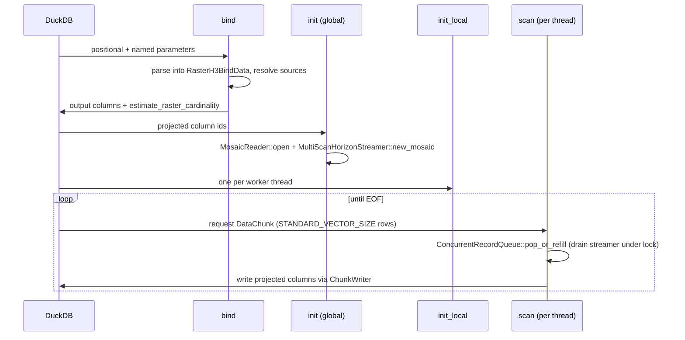

# DuckDB Deep Dive: `raster-h3-duckdb`

[← Engines Overview](README.md) · [← Back to README](../../README.md)

`raster-h3-duckdb` ([`crates/raster-h3-duckdb`](../../crates/raster-h3-duckdb)) is the
DuckDB loadable extension. It talks to DuckDB only through the stable C API (no
`libduckdb` link, no C++). The crate itself is an `rlib`; the root `raster_h3` crate
re-exports it and builds the `libraster_h3.{so,dylib,dll}` that `LOAD` opens.

DuckDB is the engine with the widest parameter coverage: every option of the core engine
(sampling, bands, spectral formulas, quantiles, remapping, compaction, worker and memory
budgets) is a named SQL parameter, and it is the only engine that transcodes
pre-aggregated Parquet into PMTiles. For every parameter and output column, see the
[DuckDB SQL API Reference](../api-reference.md).

- [Install](#install)
- [Docker Quickstart](#docker-quickstart)
- [SQL Usage & Recipes](#sql-usage--recipes)
- [Client Languages (Python, Node.js, R)](#client-languages-python-nodejs-r)
- [Build, Package, Load](#build-package-load)
  - [Community Extension Build](#community-extension-build)
- [Internals](#entry-points) — entry points, registered functions, table function lifecycle, geometry output, FFI safety
- [Troubleshooting](#troubleshooting)
- [Testing](#testing)

## Install

### Pre-compiled binaries

Pre-compiled extensions are published for all major platforms:

| Platform | Compatible Environments | Asset Filename |
| :--- | :--- | :--- |
| **`osx_arm64`** | macOS Apple Silicon (M1/M2/M3/M4) | `raster_h3-osx_arm64.duckdb_extension.gz` |
| **`osx_amd64`** | macOS Intel x86_64 | `raster_h3-osx_amd64.duckdb_extension.gz` |
| **`linux_amd64_gcc4`** | Ubuntu, Debian, CentOS, Fedora (glibc) | `raster_h3-linux_amd64_gcc4.duckdb_extension.gz` |
| **`linux_arm64`** | AWS Graviton, Raspberry Pi 4/5, AArch64 | `raster_h3-linux_arm64.duckdb_extension.gz` |
| **`windows_amd64`** | Windows 10/11, Windows Server (x64) | `raster_h3-windows_amd64.duckdb_extension.gz` |

#### Option A: Install via release URL

```sql
SET allow_unsigned_extensions = true;

-- Replace <platform> with your platform identifier (e.g. osx_arm64)
INSTALL 'https://github.com/dmuldrew/raster_h3/releases/latest/download/raster_h3-<platform>.duckdb_extension.gz';
LOAD 'raster_h3';

SELECT raster_h3_version();
```

#### Option B: Install via custom repository

```sql
SET allow_unsigned_extensions = true;
SET custom_extension_repository = 'https://github.com/dmuldrew/raster_h3/releases/latest/download';
INSTALL raster_h3;
LOAD raster_h3;
```

#### Option C: Manual download & local load

Download from [Releases](https://github.com/dmuldrew/raster_h3/releases), then:

```sql
LOAD '/path/to/raster_h3-<platform>.duckdb_extension';
```

To build the extension from source instead, see [Build, Package, Load](#build-package-load).

## Docker Quickstart

The [`Dockerfile`](../../Dockerfile) builds the workspace, packages the DuckDB extension,
installs the DuckDB CLI and a sample GeoTIFF (`/data/sample_sf.tif`), and uses
[`entrypoint.sh`](../../entrypoint.sh) to pre-load the extension for every query.

### Build the container

```bash
docker build -t raster_h3:latest .
```

### Run an interactive session

```bash
docker run -it raster_h3:latest   # runs sql/demo.sql, then opens a DuckDB shell
```

### Run SQL one-liners

```bash
# Continuous raster aggregation
docker run --rm -v $(pwd):/data raster_h3:latest \
  "SELECT h3_hex, round(mean, 2) AS avg_elevation, count FROM h3_raster_continuous_aggregate('/data/sample_sf.tif', resolution := 8) LIMIT 5;"

# Categorical aggregation
docker run --rm -v $(pwd):/data raster_h3:latest \
  "SELECT h3_hex, majority_class, round(majority_fraction * 100, 1) AS dominance_pct, total_count FROM h3_raster_categorical_aggregate('/data/sample_sf.tif', resolution := 8) LIMIT 5;"

# PMTiles v3 export
docker run --rm -v $(pwd):/data raster_h3:latest \
  "SELECT * FROM h3_raster_to_pmtiles('/data/sample_sf.tif', '/data/sample_sf.pmtiles', min_resolution := 6, max_resolution := 8);"
```

### Pipe SQL scripts

```bash
cat my_analysis.sql | docker run --rm -i -v $(pwd):/data raster_h3:latest
```

### Standalone converters

The image also contains the `raster_to_pmtiles` and `parquet_to_pmtiles` example binaries:

```bash
# GeoTIFF → PMTiles
docker run --rm -v $(pwd):/data raster_h3:latest \
  raster_to_pmtiles \
    --input /data/sample_sf.tif \
    --output /data/sample_sf.pmtiles \
    --resolutions 6,7,8 \
    --sampling rgss

# Parquet → PMTiles
docker run --rm -v $(pwd):/data raster_h3:latest \
  parquet_to_pmtiles \
    --input /data/demographics_h3.parquet \
    --output /data/demographics.pmtiles \
    --h3-col h3_index
```

### Launch the PMTiles web viewer

Using Docker Compose (recommended):

```bash
docker compose up viewer        # foreground
docker compose up -d viewer     # detached
```

Using standalone Docker:

```bash
docker run --rm -p 8080:8080 -v $(pwd):/app python:3.11-slim python3 -u /app/pmtiles_viewer/server.py 8080
```

Open **`http://localhost:8080/pmtiles_viewer/`** to visualize any `.pmtiles` file.

## SQL Usage & Recipes

### Load the extension

```sql
LOAD 'target/release/libraster_h3.dylib'; -- macOS (.so on Linux, .dll on Windows)
```

### Basic continuous aggregation

```sql
SELECT h3_index, h3_hex, mean, count, min, max, sum
FROM h3_raster_continuous_aggregate('elevation.tif', resolution := 8);
```

### Advanced parameters

```sql
SELECT
    h3_hex,
    round(mean, 2) AS avg_temp_c,
    round(count, 2) AS weighted_pixel_count
FROM h3_raster_continuous_aggregate(
    'temperature_global.tif',
    resolution := 9,
    source_crs := 'EPSG:4326',
    nodata := -9999.0,
    sampling := 'rgss',
    min_lon := -122.50, min_lat := 37.70,
    max_lon := -122.35, max_lat := 37.85
)
ORDER BY weighted_pixel_count DESC;
```

### Multiple resolutions and quantiles in one pass

```sql
SELECT resolution, h3_hex, mean, p50, p95, iqr
FROM h3_raster_continuous_aggregate(
    'elevation.tif', resolutions := '7,8,9', quantiles := 'p50,p95,iqr'
);
```

### Helper scalar functions

```sql
SELECT
    h3_to_string(h3_index) AS h3_str,
    string_to_h3('8828308281fffff') AS h3_int,
    h3_to_lat(h3_index) AS center_lat,
    h3_to_lng(h3_index) AS center_lng,
    h3_get_resolution(h3_index) AS res,
    h3_cell_to_parent(h3_index, 6) AS parent,
    mean
FROM h3_raster_continuous_aggregate('elevation.tif', 8);
```

### Spatial joins

```sql
SELECT
    r.h3_hex,
    r.mean AS avg_elevation,
    p.total_population,
    p.median_income
FROM h3_raster_continuous_aggregate('california_elevation.tif', resolution := 8) r
JOIN population_h3_table p ON r.h3_index = p.h3_index
WHERE r.mean > 500.0;
```

### Export to GeoParquet

Through DuckDB's own `COPY`:

```sql
COPY (
    SELECT h3_index, h3_hex, mean, count, min, max,
           h3_to_lat(h3_index) AS centroid_lat,
           h3_to_lng(h3_index) AS centroid_lng
    FROM h3_raster_continuous_aggregate('elevation.tif', resolution := 8, sampling := 'rgss')
) TO 'elevation_h3.parquet' (FORMAT PARQUET, COMPRESSION ZSTD);
```

Or with the streaming exporter, which writes WKB geometry and GeoParquet 1.1 metadata:

```sql
SELECT * FROM h3_raster_to_parquet(
    'elevation.tif', 'elevation_h3.parquet', resolution := 8, geoparquet := true
);
```

### Remote COG & S3 streaming

```sql
-- HTTPS
SELECT * FROM h3_raster_continuous_aggregate(
    'https://example.com/rasters/cog_elevation.tif',
    resolution := 8, sampling := 'rgss'
);

-- AWS S3
SELECT * FROM h3_raster_continuous_aggregate(
    's3://my-geospatial-bucket/landsat/scene_01.tif',
    resolution := 9
);
```

> 💡 **Tip**: For optimal remote streaming and maximum local throughput, source rasters should be formatted as tiled WGS84 COGs with $512 \times 512$ blocks. See [Optimal Raster Format & Ingestion Speed](../optimal-raster-format.md).

### Multi-file mosaics

```sql
-- Voronoi cutline partitioning (zero double-counting)
SELECT * FROM h3_raster_continuous_aggregate(
    'tiles/tile_*.tif', resolution := 8, overlap_rule := 'cutline'
);

-- Painter's Algorithm (first tile takes precedence)
SELECT * FROM h3_raster_categorical_aggregate(
    'tile_west.tif,tile_east.tif', resolution := 8, overlap_rule := 'first'
);
```

### Spectral indices (NDVI, NBR, NDWI, EVI)

```sql
SELECT * FROM h3_raster_continuous_aggregate(
    'sentinel2_l2a.tif', resolution := 9, formula := 'ndvi'
);
```

### Categorical aggregation

#### Majority class & dominance (wide format)

```sql
SELECT h3_hex, majority_class,
       round(majority_fraction * 100, 1) AS dominance_pct,
       unique_classes, total_count, histogram
FROM h3_raster_categorical_aggregate('worldcover_2021.tif', resolution := 8);
```

#### JSON histogram queries

```sql
SELECT h3_hex, majority_class,
       json_extract(histogram, '$."10"') AS forest_fraction,
       json_extract(histogram, '$."50"') AS urban_fraction
FROM h3_raster_categorical_aggregate('worldcover_2021.tif', resolution := 8)
WHERE json_extract(histogram, '$."50"') IS NOT NULL;
```

#### Long-form filtering

```sql
SELECT h3_hex, category AS urban_class, count AS urban_pixel_count,
       round(fraction * 100, 2) AS urban_coverage_pct
FROM h3_raster_categorical_aggregate('worldcover_2021.tif', resolution := 8, format := 'long')
WHERE category = 50 AND fraction >= 0.25
ORDER BY fraction DESC;
```

### PMTiles v3 export

```sql
SELECT * FROM h3_raster_to_pmtiles(
    'california_elevation.tif', 'california_elevation.pmtiles',
    min_resolution := 6, max_resolution := 8, sampling := 'rgss'
);

-- Pre-aggregated H3 Parquet → PMTiles
SELECT * FROM h3_parquet_to_pmtiles('demographics_h3.parquet', 'demographics.pmtiles');
```

`h3_column` (alias `h3_col`) selects the H3 column case-insensitively; if omitted,
`h3_index`/`h3_hex`/`h3`/`cell`/`hex` is auto-detected, else column 0; an explicit
name that doesn't exist returns `status = 'ERROR: H3 column ... not found ...; available columns: ...'`
with `total_hexagons = 0` and writes no file.

See [PMTiles & Multi-Resolution](../pmtiles.md) for zoom mapping and viewer setup.

## Client Languages (Python, Node.js, R)

These examples load the extension from each language's DuckDB client. For the native
Python package that does not need DuckDB (Arrow streams, Polars `LazyFrame`s), see
[Python & Polars](python-polars.md).

### Python

```python
import duckdb

con = duckdb.connect(config={'allow_unsigned_extensions': 'true'})
con.load_extension('target/release/libraster_h3.dylib')

df = con.execute("""
    SELECT h3_hex, round(mean, 2) AS mean_elevation, count AS pixel_count
    FROM h3_raster_continuous_aggregate('california_elevation.tif', resolution := 8, sampling := 'rgss')
    ORDER BY pixel_count DESC LIMIT 10;
""").df()

print(df)
```

### Node.js

```javascript
const duckdb = require('duckdb');
const db = new duckdb.Database(':memory:', { allow_unsigned_extensions: 'true' });

db.all("LOAD 'target/release/libraster_h3.dylib';", (err) => {
  if (err) throw err;
  db.all(`SELECT h3_hex, round(mean, 2) AS avg_elevation, count
    FROM h3_raster_continuous_aggregate('california_elevation.tif', resolution := 8) LIMIT 5;`,
    (err, rows) => { if (err) throw err; console.table(rows); });
});
```

### R

```r
library(DBI); library(duckdb)
con <- dbConnect(duckdb::duckdb(), config = list("allow_unsigned_extensions" = "true"))
dbExecute(con, "LOAD 'target/release/libraster_h3.dylib';")
res <- dbGetQuery(con, "SELECT h3_hex, majority_class, majority_fraction, total_count
    FROM h3_raster_categorical_aggregate('worldcover_2021.tif', resolution := 8) LIMIT 10;")
print(res)
```

## Build, Package, Load

```bash
# Loadable library (root crate links raster-h3-duckdb)
cargo build --release
# -> target/release/libraster_h3.dylib (macOS) / .so (Linux) / .dll (Windows)

# Optional: append the DuckDB extension metadata footer
cargo run --release --bin package_extension -- \
    --input target/release/libraster_h3.so \
    --output target/release/raster_h3.duckdb_extension
```

```sql
-- Unsigned local builds need allow_unsigned_extensions (or `duckdb -unsigned`)
LOAD 'target/release/libraster_h3.dylib';
SELECT * FROM h3_raster_continuous_aggregate('dem.tif', resolution := 8) LIMIT 5;
```

### Community Extension Build

The root [`Makefile`](../../Makefile) wraps DuckDB's
[`extension-ci-tools`](https://github.com/duckdb/extension-ci-tools) `c_api_extensions`
makefiles (git submodule), which is what the
[DuckDB community-extensions](https://github.com/duckdb/community-extensions) CI runs for
`build: cargo`. It builds the root crate and appends the footer with DuckDB's own
`append_extension_metadata.py` (stable `C_STRUCT` ABI, minimum DuckDB `v1.2.0`).

```bash
git submodule update --init
make configure      # Python venv (duckdb + sqllogictest runner), platform and version detection
make release        # -> build/release/raster_h3.duckdb_extension
make test_release   # runs test/sql/*.test (skipped on linux_amd64 by extension-ci-tools)
```

The submission manifest is [`packaging/duckdb-community/description.yml`](../../packaging/duckdb-community/description.yml).
It is a copy of the file submitted to `duckdb/community-extensions` as
`extensions/raster_h3/description.yml`; `repo.ref` must name a commit on this repository that
contains the `Makefile` and submodule.

## Entry Points

| Symbol | Called by | Behaviour |
| :--- | :--- | :--- |
| `raster_h3_init_c_api(info, access)` | DuckDB ≥ 1.2 (C-API extensions) | Fetches the database handle from the access table and calls `raster_h3_init`. A panic is reported through `access->set_error`. |
| `raster_h3_init(db)` | Older loaders, and `raster_h3_init_c_api` | Opens a connection (closed by an RAII guard on every path) and registers all functions. Returns `false` if any registration fails. |
| `raster_h3_version()` | DuckDB | Returns the C-API version string `v0.0.1`. |

The root crate keeps these symbols in the shared library through
`raster_h3::_keep_duckdb_c_api_symbols`.

## Registered Functions

| SQL name | Kind | Source |
| :--- | :--- | :--- |
| `h3_raster_continuous_aggregate` | table | [`table_function.rs`](../../crates/raster-h3-duckdb/src/functions/table_function.rs) |
| `h3_raster_categorical_aggregate` | table (`format := 'wide' \| 'long'`) | [`categorical_table_function.rs`](../../crates/raster-h3-duckdb/src/functions/categorical_table_function.rs) |
| `h3_raster_to_parquet` | table (1 summary row) | [`parquet_table_function.rs`](../../crates/raster-h3-duckdb/src/functions/parquet_table_function.rs) |
| `h3_raster_to_pmtiles`, `h3_parquet_to_pmtiles` | table (1 summary row) | [`pmtiles_table_function.rs`](../../crates/raster-h3-duckdb/src/functions/pmtiles_table_function.rs) |
| `h3_to_string`, `string_to_h3`, `h3_to_lat`, `h3_to_lng`, `h3_get_resolution`, `h3_is_valid` (UBIGINT/VARCHAR), `h3_to_wkb` (UBIGINT/VARCHAR), `h3_cell_to_parent` (UBIGINT/VARCHAR), `h3_to_geometry` / `h3_cell_to_geometry` (UBIGINT/VARCHAR), `h3_polygon_to_cells` (BLOB, plus GEOMETRY on DuckDB ≥ 1.5; returns `UBIGINT[]`) | scalar | [`scalar.rs`](../../crates/raster-h3-duckdb/src/functions/scalar.rs) |

The scalar kernels call `raster_h3_core::scalar_ops`, so their results match the other
engines (with the `0` vs `NULL` differences listed in the
[overview](README.md#scalar-helpers)).

## Table Function Lifecycle



- **Bind** (`BindHelper`, [`bind_utils/`](../../crates/raster-h3-duckdb/src/functions/bind_utils))
  reads arguments through RAII `OwnedValue` guards, resolves paths/globs/VRTs, declares
  output columns (including one column per requested quantile) and reports a cardinality
  estimate from `raster_h3_core::scalar_ops::estimate_raster_cardinality`.
- **Init** builds `MultiResolutionConfig` from the bind data (resolutions, CRS, NoData,
  bbox, sampling, band, spectral formula, quantiles, value filters, compaction, execution
  budgets) and opens the shared streamer.
- **Projection pushdown** is enabled; only projected columns are written, so unselected
  `h3_hex`, `wkb` or `histogram` columns are never formatted.
- **Scan** threads share one `ConcurrentRecordQueue`. Refill is demand-driven: a thread
  that finds the queue empty drains up to a few vectors of completed cells from the
  streamer; nothing runs in the background while DuckDB is not pulling, so `LIMIT` stops
  aggregation promptly.

## Geometry Output

[`spatial_detect.rs`](../../crates/raster-h3-duckdb/src/ffi/spatial_detect.rs) looks up the
host DuckDB version at runtime (`dlsym` / `GetProcAddress`) and can probe whether the
`spatial` extension is loaded. `h3_to_geometry` / `h3_cell_to_geometry` return the native
`GEOMETRY` type on DuckDB ≥ 1.5; on older versions they return a WKB `BLOB` aliased as
`GEOMETRY`, the convention the `spatial` extension uses. `h3_to_wkb` always returns a
plain `BLOB`. Cells crossing the antimeridian are `MULTIPOLYGON`s and the two pole cells
are polar-cap polygons; see [cell geometry](../api-reference.md#cell-geometry).

## FFI Safety

- Every callback (bind, init, init_local, scan, scalar, destructors) runs inside
  `ffi_*_guard` wrappers that catch panics and convert them to DuckDB errors; secondary
  panics during error reporting are contained as well.
- Scalar functions report errors with `duckdb_scalar_function_set_error`, table functions
  with the bind/init/function error setters.
- Early termination (`LIMIT`, cancellation) runs the registered destructors, which close
  the prefetch queues and join decode/HTTP worker threads before freeing buffers.

## Troubleshooting

### Missing pixels near a projection's edge

`h3_raster_to_parquet` and `h3_raster_to_pmtiles` return a `transform_failures` count in their
summary row: valid pixels dropped because their coordinate transform failed or fell outside
the valid latitude/longitude range. A non-zero value usually means a wrong `source_crs`. The
streaming aggregate functions do not report this (DuckDB table functions have no warnings
channel); run an export, or use another engine, to check a raster. See
[transform-failure diagnostics](core.md#transform-failure-diagnostics).

### Unsigned extension loading errors

`Error: Extension ".../libraster_h3.dylib" is not signed by DuckDB`

**Resolution**: Launch DuckDB with `-unsigned`, or set the config flag before loading:

```python
con = duckdb.connect(config={'allow_unsigned_extensions': 'true'})
con.load_extension('target/release/libraster_h3.dylib')
```

### Missing CRS

Pass `source_crs` (alias `crs`) when a GeoTIFF has no embedded projection tags:

```sql
SELECT * FROM h3_raster_continuous_aggregate(
    'unprojected_grid.tif', resolution := 8, source_crs := 'EPSG:32610'
);
```

Engine-independent issues (CRS detection, antimeridian, codecs, `mmap`) are covered in the
README's [Troubleshooting](../../README.md#troubleshooting--common-pitfalls) section.

## Testing

| Test | Scope |
| :--- | :--- |
| `crates/raster-h3-duckdb/tests/it/ffi_sql.rs`, `tests/it/duckdb_sql_smoke.rs` | SQL through a real DuckDB CLI when available |
| `tests/it/package_extension.rs` | Extension footer packaging |
| `tests/it/multi_engine_e2e.rs` | DuckDB results compared with the other engines when `duckdb` is on `PATH` |
| `cargo test -p raster-h3-duckdb` | Crate unit tests and its `tests/it` binary (uses the core `test-hooks` feature) |
