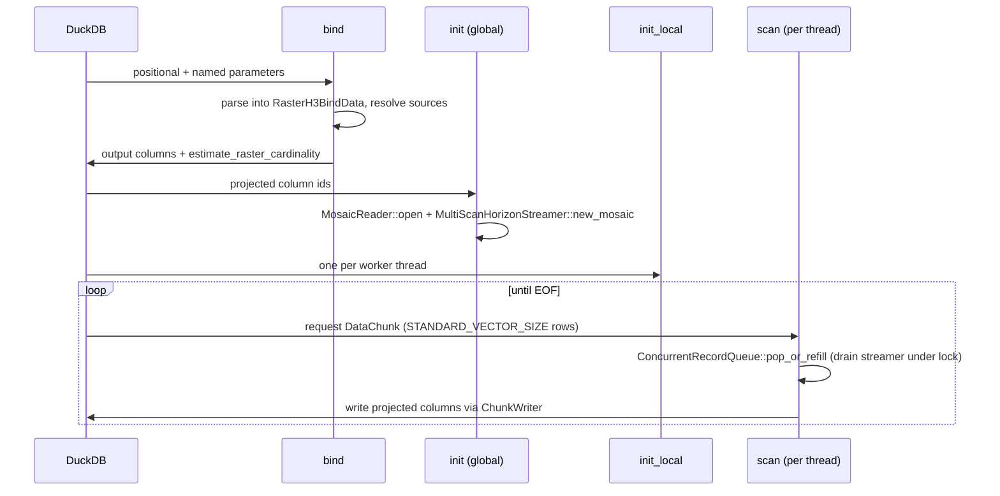

# DuckDB Deep Dive: `raster-h3-duckdb`

[← Engines Overview](README.md) · [← Back to README](../../README.md)

`raster-h3-duckdb` ([`crates/raster-h3-duckdb`](../../crates/raster-h3-duckdb)) is the
DuckDB loadable extension. It talks to DuckDB only through the stable C API (no
`libduckdb` link, no C++), and contains the code that used to be `src/ffi/` and
`src/functions/`. The crate itself is an `rlib`; the root `raster_h3` crate re-exports it
and builds the `libraster_h3.{so,dylib,dll}` that `LOAD` opens.

For every SQL parameter and output column, see the [API Reference](../api-reference.md).
This page covers how the extension is built, loaded and executed.

## Build, Package, Load

```bash
# Loadable library (root crate links raster-h3-duckdb)
cargo build --release
# -> target/release/libraster_h3.dylib (macOS) / .so (Linux) / .dll (Windows)

# Optional: append the DuckDB extension metadata footer
cargo run --release --bin package_extension -- \
    --input target/release/libraster_h3.so \
    --output target/release/raster_h3.duckdb_extension
```

```sql
-- Unsigned local builds need allow_unsigned_extensions (or `duckdb -unsigned`)
LOAD 'target/release/libraster_h3.dylib';
SELECT * FROM h3_raster_continuous_aggregate('dem.tif', resolution := 8) LIMIT 5;
```

Pre-built `.duckdb_extension.gz` assets and `INSTALL` options are described in the
[README](../../README.md#installation--docker-quickstart).

## Entry Points

| Symbol | Called by | Behaviour |
| :--- | :--- | :--- |
| `raster_h3_init_c_api(info, access)` | DuckDB ≥ 1.2 (C-API extensions) | Fetches the database handle from the access table and calls `raster_h3_init`. A panic is reported through `access->set_error`. |
| `raster_h3_init(db)` | Older loaders, and `raster_h3_init_c_api` | Opens a connection (closed by an RAII guard on every path) and registers all functions. Returns `false` if any registration fails. |
| `raster_h3_version()` | DuckDB | Returns the C-API version string `v0.0.1`. |

The root crate keeps these symbols in the shared library through
`raster_h3::_keep_duckdb_c_api_symbols`.

## Registered Functions

| SQL name | Kind | Source |
| :--- | :--- | :--- |
| `h3_raster_continuous_aggregate` | table | [`table_function.rs`](../../crates/raster-h3-duckdb/src/functions/table_function.rs) |
| `h3_raster_categorical_aggregate` | table (`format := 'wide' \| 'long'`) | [`categorical_table_function.rs`](../../crates/raster-h3-duckdb/src/functions/categorical_table_function.rs) |
| `h3_raster_to_parquet` | table (1 summary row) | [`parquet_table_function.rs`](../../crates/raster-h3-duckdb/src/functions/parquet_table_function.rs) |
| `h3_raster_to_pmtiles`, `h3_parquet_to_pmtiles` | table (1 summary row) | [`pmtiles_table_function.rs`](../../crates/raster-h3-duckdb/src/functions/pmtiles_table_function.rs) |
| `h3_to_string`, `string_to_h3`, `h3_to_lat`, `h3_to_lng`, `h3_get_resolution`, `h3_is_valid` (UBIGINT/VARCHAR), `h3_to_wkb` (UBIGINT/VARCHAR), `h3_cell_to_parent` (UBIGINT/VARCHAR), `h3_to_geometry` / `h3_cell_to_geometry` (UBIGINT/VARCHAR) | scalar | [`scalar.rs`](../../crates/raster-h3-duckdb/src/functions/scalar.rs) |

The scalar kernels call `raster_h3_core::scalar_ops`, so their results match the other
engines (with the `0` vs `NULL` differences listed in the
[overview](README.md#scalar-helpers)).

## Table Function Lifecycle



- **Bind** (`BindHelper`, [`bind_utils/`](../../crates/raster-h3-duckdb/src/functions/bind_utils))
  reads arguments through RAII `OwnedValue` guards, resolves paths/globs/VRTs, declares
  output columns (including one column per requested quantile) and reports a cardinality
  estimate from `raster_h3_core::scalar_ops::estimate_raster_cardinality`.
- **Init** builds `MultiResolutionConfig` from the bind data (resolutions, CRS, NoData,
  bbox, sampling, band, spectral formula, quantiles, value filters, compaction, execution
  budgets) and opens the shared streamer.
- **Projection pushdown** is enabled; only projected columns are written, so unselected
  `h3_hex`, `wkb` or `histogram` columns are never formatted.
- **Scan** threads share one `ConcurrentRecordQueue`. Refill is demand-driven: a thread
  that finds the queue empty drains up to a few vectors of completed cells from the
  streamer; nothing runs in the background while DuckDB is not pulling, so `LIMIT` stops
  aggregation promptly.

## Geometry Output

[`spatial_detect.rs`](../../crates/raster-h3-duckdb/src/ffi/spatial_detect.rs) looks up the
host DuckDB version at runtime (`dlsym` / `GetProcAddress`) and can probe whether the
`spatial` extension is loaded. `h3_to_geometry` / `h3_cell_to_geometry` return the native
`GEOMETRY` type on DuckDB ≥ 1.5; on older versions they return a WKB `BLOB` aliased as
`GEOMETRY`, the convention the `spatial` extension uses. `h3_to_wkb` always returns a
plain `BLOB`.

## FFI Safety

- Every callback (bind, init, init_local, scan, scalar, destructors) runs inside
  `ffi_*_guard` wrappers that catch panics and convert them to DuckDB errors; secondary
  panics during error reporting are contained as well.
- Scalar functions report errors with `duckdb_scalar_function_set_error`, table functions
  with the bind/init/function error setters.
- Early termination (`LIMIT`, cancellation) runs the registered destructors, which close
  the prefetch queues and join decode/HTTP worker threads before freeing buffers.

## Testing

| Test | Scope |
| :--- | :--- |
| `crates/raster-h3-duckdb/tests/it/ffi_sql.rs`, `tests/it/duckdb_sql_smoke.rs` | SQL through a real DuckDB CLI when available |
| `tests/it/package_extension.rs` | Extension footer packaging |
| `tests/it/multi_engine_e2e.rs` | DuckDB results compared with the other engines when `duckdb` is on `PATH` |
| `cargo test -p raster-h3-duckdb` | Crate unit tests and its `tests/it` binary (uses the core `test-hooks` feature) |
