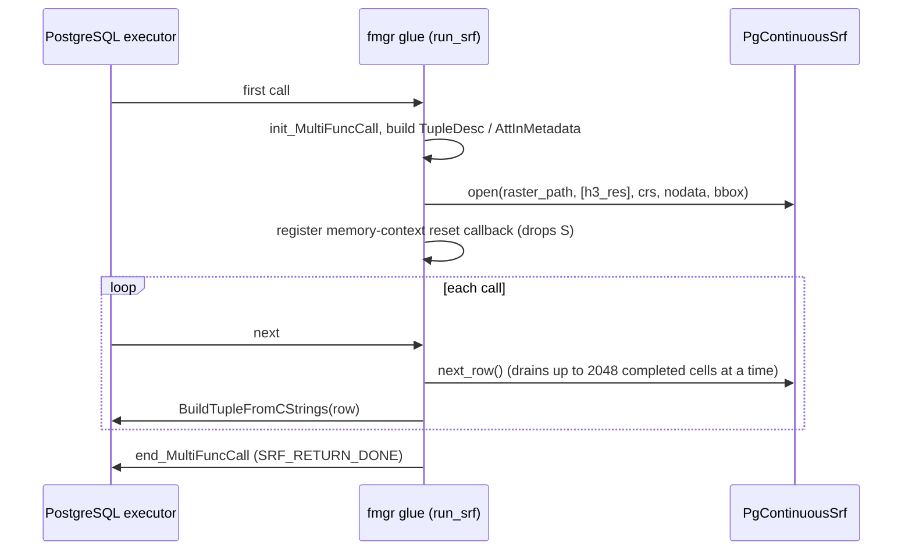

# PostgreSQL Deep Dive: `raster-h3-pg`

[← Engines Overview](README.md) · [← Back to README](../../README.md)

`raster-h3-pg` ([`crates/raster-h3-pg`](../../crates/raster-h3-pg)) is a native PostgreSQL
extension written directly against the V1 function-manager (`fmgr`) C ABI. It has no
`pgrx` dependency and no C shim. It adds raster aggregation set-returning functions (SRFs)
and H3 scalar helpers to PostgreSQL 13 through 18.

The crate has two layers:

| Layer | Built when | Contents |
| :--- | :--- | :--- |
| [`src/lib.rs`](../../crates/raster-h3-pg/src/lib.rs) | always | fmgr ABI structs (`Datum`, `NullableDatum`, `FunctionCallInfoBaseData`, `Pg_finfo_record`), the pure-Rust SRF iterators `PgContinuousSrf` / `PgCategoricalSrf`, the integer/float scalar entry points, and a C SRF API (`pg_srf_continuous_open/next/close`). Testable without a server. |
| [`src/fmgr.rs`](../../crates/raster-h3-pg/src/fmgr.rs) | `--features pg-extension` | `PG_MODULE_MAGIC`, the `text`/`bytea` functions, and the value-per-call SRF glue that calls server symbols (`palloc`, `ereport`, `funcapi`). Only links inside a PostgreSQL backend. |

## Build & Install

The magic block layout and the `ERROR` level differ between PostgreSQL majors, so the
module must be compiled for the server's major version.
[`build.rs`](../../crates/raster-h3-pg/build.rs) reads `RASTER_H3_PG_MAJOR`, or else runs
`$PG_CONFIG --version` (default `pg_config`), and rejects majors outside 13–18.

```bash
# Build for the server on PATH
cargo build --release -p raster-h3-pg --features pg-extension

# Or pin the major explicitly (e.g. cross-building in CI)
RASTER_H3_PG_MAJOR=16 cargo build --release -p raster-h3-pg --features pg-extension
```

Install the three files where the server looks for them:

```bash
cp target/release/libraster_h3_pg.so  "$(pg_config --pkglibdir)/raster_h3_pg.so"
cp crates/raster-h3-pg/raster_h3.control       "$(pg_config --sharedir)/extension/"
cp crates/raster-h3-pg/sql/raster_h3--0.4.0.sql "$(pg_config --sharedir)/extension/"
```

On macOS the library is `libraster_h3_pg.dylib`; install it as `raster_h3_pg.dylib` (or
the suffix your server expects). Then:

```sql
CREATE EXTENSION raster_h3;
```

[`raster_h3.control`](../../crates/raster-h3-pg/raster_h3.control) declares version `0.4.0`,
`module_pathname = '$libdir/raster_h3_pg'`, `relocatable = true` and `superuser = true`.

The raster aggregation functions read files with the server's OS privileges, so `EXECUTE` on
them is revoked from `PUBLIC` and granted only to `pg_read_server_files` (as with
`COPY ... FROM` a file). Grant that role to users who need them:

```sql
GRANT pg_read_server_files TO analyst;
```

The module requires a little-endian, 64-bit target (pass-by-value `float8`/`int8` Datums);
other targets fail to compile.

## SQL API

All definitions are in [`sql/raster_h3--0.4.0.sql`](../../crates/raster-h3-pg/sql/raster_h3--0.4.0.sql).

### Raster aggregation

```sql
h3_raster_continuous_aggregate(
    raster_path text,
    h3_res      integer          DEFAULT 8,
    source_crs  text             DEFAULT NULL,
    nodata      double precision DEFAULT NULL,
    bbox        text             DEFAULT NULL   -- 'min_lon,min_lat,max_lon,max_lat'
) RETURNS TABLE (...)

h3_raster_categorical_aggregate(same arguments) RETURNS TABLE (...)
```

Both are `VOLATILE PARALLEL SAFE` and return one resolution per call. Validation errors
are raised as PostgreSQL `ERROR`s:

- `raster_path` must be non-empty (globs, comma-separated lists and VRTs are accepted;
  overlaps use the `cutline` rule).
- `h3_res` must be in `0..=15`; `NULL` means 8.
- An empty `source_crs` or `bbox` string is treated as `NULL`; a malformed `bbox` is an error.

`raster_path` is opened **by the server process**, so it must be readable by the
PostgreSQL OS user on the database host (or be an HTTP(S)/S3 URL the server can reach).

### Output columns

| Continuous | Type | | Categorical | Type |
| :--- | :--- | :- | :--- | :--- |
| `h3_index` | `bigint` | | `h3_index` | `bigint` |
| `h3_hex` | `text` | | `h3_hex` | `text` |
| `mean` | `double precision` | | `majority_class` | `bigint` |
| `stddev` | `double precision` (NULL when undefined) | | `majority_fraction` | `double precision` |
| `count` | `double precision` | | `majority_count` | `double precision` |
| `min`, `max`, `sum` | `double precision` | | `unique_classes` | `bigint` |
| `resolution` | `smallint` | | `total_count` | `double precision` |
| `wkb` | `bytea` (WKB polygon) | | `histogram` | `text` (JSON) |
| | | | `resolution` | `smallint` |
| | | | `shannon_entropy` | `double precision` |
| | | | `wkb` | `bytea` |

`wkb` (and `h3_to_wkb`) is a `MULTIPOLYGON` for cells crossing the antimeridian and a
polar-cap polygon for the two pole cells, so `ST_GeomFromWKB` works without wrapping; see
[cell geometry](../sql-api-reference.md#cell-geometry).

`h3_index` is the unsigned H3 index reinterpreted as `bigint` (the `h3-pg` convention);
valid cells are always positive.

### Scalar helpers

| Function | Notes |
| :--- | :--- |
| `h3_to_string(bigint) → text` | |
| `string_to_h3(text) → bigint` | `NULL` when the text is not hexadecimal |
| `h3_to_lat(bigint)`, `h3_to_lng(bigint) → double precision` | `NaN` for invalid cells |
| `h3_get_resolution(bigint) → bigint` | `-1` for invalid cells |
| `h3_is_valid(bigint) → boolean`, `h3_is_valid(text) → boolean` | |
| `h3_to_wkb(bigint) → bytea` | |
| `h3_cell_to_parent(bigint, bigint) → bigint` | `NULL` when the target resolution is invalid or finer than the cell |

All are `IMMUTABLE STRICT PARALLEL SAFE`.

## Recipes

These mirror the [DuckDB SQL recipes](duckdb.md#sql-usage--recipes) for the arguments the
PostgreSQL functions accept. Paths are read by the server process (see above).

### Basic continuous aggregation

```sql
CREATE EXTENSION raster_h3;

SELECT h3_index, h3_hex, mean, count, min, max, sum
FROM h3_raster_continuous_aggregate('/data/elevation.tif', 8);
```

### CRS, NoData and bounding box

```sql
SELECT h3_hex, round(mean::numeric, 2) AS avg_temp_c, count
FROM h3_raster_continuous_aggregate(
    '/data/temperature_global.tif',
    h3_res     => 9,
    source_crs => 'EPSG:4326',
    nodata     => -9999,
    bbox       => '-122.50,37.70,-122.35,37.85'
)
ORDER BY count DESC;
```

### Several resolutions

Each call aggregates one resolution, so a multi-resolution result is one call (one raster
pass) per resolution:

```sql
SELECT r.*
FROM generate_series(6, 8) AS res,
     LATERAL h3_raster_continuous_aggregate('/data/elevation.tif', res) AS r;
```

### Helper scalar functions

```sql
SELECT
    h3_to_string(h3_index)              AS h3_str,
    string_to_h3('8828308281fffff')     AS h3_int,
    h3_to_lat(h3_index)                 AS center_lat,
    h3_to_lng(h3_index)                 AS center_lng,
    h3_get_resolution(h3_index)         AS res,
    h3_cell_to_parent(h3_index, 6)      AS parent,
    mean
FROM h3_raster_continuous_aggregate('/data/elevation.tif', 8);
```

### Joins and PostGIS

```sql
-- Join with an H3-indexed table (bigint h3_index)
SELECT r.h3_hex, r.mean AS avg_elevation, p.total_population, p.median_income
FROM h3_raster_continuous_aggregate('/data/california_elevation.tif', 8) AS r
JOIN population_h3 AS p USING (h3_index)
WHERE r.mean > 500.0;

-- Materialise with PostGIS geometry and index it
CREATE TABLE landcover_h3 AS
SELECT h3_index, majority_class, majority_fraction,
       ST_GeomFromWKB(wkb, 4326) AS geom
FROM h3_raster_categorical_aggregate('/data/landcover.tif', h3_res => 8);

CREATE INDEX ON landcover_h3 (h3_index);
CREATE INDEX ON landcover_h3 USING gist (geom);

-- Roll up to a coarser parent resolution
SELECT h3_to_string(h3_cell_to_parent(h3_index, 5)) AS parent, avg(majority_fraction)
FROM landcover_h3
GROUP BY 1;
```

### Export

The PostgreSQL extension has no Parquet or PMTiles writer. Export with `COPY` (or `\copy`
from `psql` to write on the client):

```sql
\copy (SELECT h3_index, h3_hex, mean, count FROM h3_raster_continuous_aggregate('/data/elevation.tif', 8)) TO 'elevation_h3.csv' CSV HEADER
```

For GeoParquet or PMTiles, run the [CLI](cli.md) or [Python](python-polars.md) exporters on
the same raster.

### Remote COG & S3 streaming

```sql
SELECT * FROM h3_raster_continuous_aggregate('https://example.com/rasters/cog_elevation.tif', 8);
SELECT * FROM h3_raster_continuous_aggregate('s3://my-geospatial-bucket/landsat/scene_01.tif', 9);
```

### Multi-file mosaics

```sql
SELECT * FROM h3_raster_continuous_aggregate('/data/tiles/tile_*.tif', 8);              -- cutline
SELECT * FROM h3_raster_categorical_aggregate('/data/tile_west.tif,/data/tile_east.tif', 8);
```

### Categorical aggregation

```sql
-- Majority class & dominance
SELECT h3_hex, majority_class,
       round((majority_fraction * 100)::numeric, 1) AS dominance_pct,
       unique_classes, total_count, histogram
FROM h3_raster_categorical_aggregate('/data/worldcover_2021.tif', 8);

-- Histogram queries (histogram is JSON text)
SELECT h3_hex, majority_class,
       (histogram::jsonb ->> '10')::float8 AS forest_fraction,
       (histogram::jsonb ->> '50')::float8 AS urban_fraction
FROM h3_raster_categorical_aggregate('/data/worldcover_2021.tif', 8)
WHERE histogram::jsonb ? '50';

-- Long form: there is no format argument, so unnest the histogram
SELECT c.h3_hex, h.key::bigint AS category, h.value::float8 AS fraction
FROM h3_raster_categorical_aggregate('/data/worldcover_2021.tif', 8) AS c,
     LATERAL jsonb_each_text(c.histogram::jsonb) AS h
WHERE h.key = '50' AND h.value::float8 >= 0.25
ORDER BY fraction DESC;
```

## Troubleshooting

| Error | Cause / fix |
| :--- | :--- |
| `permission denied for function h3_raster_continuous_aggregate` | `EXECUTE` is granted only to `pg_read_server_files`; `GRANT pg_read_server_files TO <role>`. |
| `incompatible library "...raster_h3_pg...": version mismatch` | The module was built for another major. Rebuild with `RASTER_H3_PG_MAJOR=<server major>` or the server's `pg_config` on `PATH`. |
| `WARNING: raster_h3: N valid sample(s) were dropped ...` | Some valid pixels could not be placed because their coordinate transform failed or fell outside the valid latitude/longitude range. Check `source_crs`; see [transform-failure diagnostics](core.md#transform-failure-diagnostics). |
| File not found for a path that exists on your machine | The server opens the path on the database host as the PostgreSQL OS user. Copy the file there, mount it into the container, or use an HTTP(S)/S3 URL. |
| `No CRS detected` | Pass `source_crs => 'EPSG:…'`. |
| Need sampling, bands, spectral formulas, quantiles, `format => 'long'` or exports | Not exposed in PostgreSQL. Use [DuckDB](duckdb.md), [Python](python-polars.md) or the [CLI](cli.md). |

## Execution Model



- **Value-per-call SRF**: rows are produced one at a time from a 2048-record buffer that
  is refilled from the horizon streamer, so the server never materialises the whole result.
- **Cleanup**: the Rust state lives in the multi-call memory context and is dropped by a
  context reset callback. That covers normal completion, early termination (`LIMIT`,
  cursor close) and error aborts.
- **Errors**: PostgreSQL reports errors with `longjmp`, which would skip Rust destructors.
  Every entry point finishes its Rust work, copies the message into `palloc`'d memory, and
  only then calls `ereport(ERROR, ...)`. Panics are caught and turned into errors the same
  way.
- **Single resolution**: the SQL API passes one `h3_res`; use multiple calls (or
  `UNION ALL`) for several resolutions.

## Rust & C API Without a Server

`PgContinuousSrf::open(path, resolutions, crs, nodata, bbox)` and
`PgCategoricalSrf::open(...)` are ordinary iterators yielding `PgContinuousRow` /
`PgCategoricalRow` in PostgreSQL types, usable from Rust tests or other hosts. The C
functions `pg_srf_continuous_open`, `pg_srf_continuous_next` (`1` row, `0` EOF, `-1`
error) and `pg_srf_continuous_close` wrap the continuous iterator, and the scalar entry
points (`pg_h3_to_lat`, `pg_h3_get_resolution`, …) can be called with a
`FunctionCallInfoBaseData::with_args(...)`.

## Testing

| Test | Requires | Command |
| :--- | :--- | :--- |
| Crate unit tests | — | `cargo test -p raster-h3-pg` |
| In-process SRF / fmgr parity | — | `cargo test -p raster_h3 --test it multi_engine_e2e` |
| Real server | Docker | `cargo test -p raster_h3 --test it pg_extension_e2e -- --ignored --nocapture` |

The real-server test runs [`scripts/pg_e2e.sh`](../../scripts/pg_e2e.sh) for each major in
`RASTER_H3_PG_VERSIONS` (comma-separated, default `16`). The script builds the module in
`rust:1-bookworm` with `RASTER_H3_PG_MAJOR` set, starts `postgres:<major>-bookworm`, installs
the library, control and SQL files using the container's `pg_config`, and waits for the
server. The test then compares `psql` output with the in-process SRF results and checks
error handling. Set `RASTER_H3_PG_E2E_KEEP=1` to keep the containers for manual sessions:

```bash
scripts/pg_e2e.sh 17                       # build + start, prints the container name
docker exec -it raster-h3-pg-e2e-17 psql -U postgres
scripts/pg_e2e.sh 17 --stop
```

`RASTER_H3_PG_RUST_IMAGE` and `RASTER_H3_PG_IMAGE` override the build and server images.
