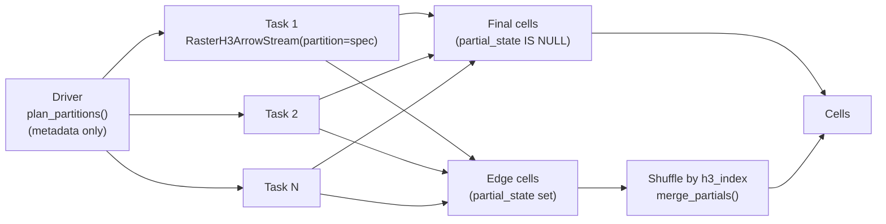

# Apache Spark & Apache Sedona

[← Back to Engine Overview](README.md) · [Python & Polars](python-polars.md) · [Core Engine](core.md#partitioned-scans)

`raster_h3` runs on Apache Spark through its Python package. There is no Spark plugin or JVM
code: each Spark task opens the raster with the `raster_h3` native library and hands Arrow
batches to Spark. On Spark 4.0+, `raster_h3.spark` registers a `raster_h3` data source
(`spark.read.format("raster_h3")`); on any Spark version the same steps can be written with
`mapInArrow`. A raster is split into **partitions** of TIFF tiles or
strips, so many executors read one raster in parallel without reading any pixel twice, and
the result is identical to a single scan (up to floating-point summation order).

Apache Sedona adds spatial SQL on top: the cells' WKB loads as Sedona geometry, and
Sedona's H3 functions (h3-java) use the same 64-bit cell ids as `raster_h3`, so they join
directly onto the aggregated cells.

Apache Sedona on Spark is separate from **SedonaDB**, the single-node DataFusion engine,
which has its own native adapter (`raster-h3-sedona`, see
[DataFusion & SedonaDB](datafusion.md#using-with-apache-datafusion-and-sedonadb)).

## How it works



1. **Plan on the driver.** `raster_h3.plan_partitions(path, target_chunks=N)` reads only
   the raster's metadata and returns one JSON spec per partition: a rectangle of the TIFF
   chunk grid plus a fingerprint of the raster layout.
2. **Scan one partition per task.** `RasterH3ArrowStream(path, resolutions, partition=spec)`
   aggregates that partition's pixels and adds a nullable `partial_state` column.
3. **Keep final cells, merge edge cells.** Rows with a null `partial_state` are complete.
   The others are cells that another partition also reaches: shuffle them by `h3_index` so
   every share of a cell meets in one task, and combine them with
   `raster_h3.merge_partials`. Edge cells are typically a few percent of the output.

## Setup

Every executor needs the `raster_h3` Python package (with its native library) and
`pyarrow>=15`, and must be able to open the raster path: a file system that all executors
mount at the same path, or an `http(s)://` / `s3://` URL that `raster_h3` reads directly
(see [Remote COG & S3 streaming](python-polars.md#remote-cog--s3-streaming)).

The quickest start is the `sedona` Docker image, Apache Sedona 1.9.1 (Spark standalone,
PySpark, Sedona and JupyterLab) with the locally built `raster-h3` wheel:

```bash
docker compose up --build sedona     # JupyterLab on http://localhost:8888, Spark UI on :8090
docker compose exec sedona python3 /opt/raster_h3/examples/raster_h3_spark_demo.py --verify
```

`./data` is mounted at `/data`. `SEDONA_DRIVER_MEM` and `SEDONA_EXECUTOR_MEM` (default
`4g` each) size the JVMs. On your own cluster, install the wheel built from
`crates/raster-h3-python` on every node, as [`Dockerfile.sedona`](../../Dockerfile.sedona)
does.

## The `raster_h3` data source (Spark 4.0+)

`raster_h3.spark` implements Spark's Python Data Source API, so a raster loads like any
other source, from Python or SQL:

```python
import raster_h3.spark

raster_h3.spark.register(spark)
df = (spark.read.format("raster_h3")
      .option("resolutions", "8,9")
      .option("target_chunks", 256)
      .load("s3://bucket/dem.tif"))
cells = raster_h3.spark.merge_partials(df)          # final cells, no partial_state

# Or both steps at once, with the options as Python values:
cells = raster_h3.spark.read(spark, "dem.tif", resolutions=[8, 9], quantiles="p50")
```

```sql
CREATE TEMPORARY VIEW dem_parts USING raster_h3
OPTIONS (path 'dem.tif', resolutions '8,9', target_chunks '256');

-- Final cells in SQL alone: raster_h3_merge is registered by raster_h3.spark.register
SELECT * FROM raster_h3_merge(TABLE(dem_parts));
SELECT * FROM raster_h3_merge(TABLE(dem_parts), 'quantiles=p50, min_count=20');
```

- **One Spark partition per raster partition.** The driver plans with `plan_partitions`
  (metadata only); each Spark task scans one spec, so `df.rdd.getNumPartitions()` is the
  number of planned partitions.
- **Schema.** The scan's columns with Spark's signed types (`h3_index` `bigint`,
  `resolution` `smallint`) plus `partial_state` (`binary`).
- **`merge_partials(df, ...)`** shuffles the rows by `h3_index` once, passes final rows
  through and merges the partial ones with `raster_h3.merge_partials`; the raster is scanned
  once. Pass the scan's `categorical`, `columns`, `quantiles` and filters; `read` does this
  for you. Merge each raster's DataFrame on its own.
- **`raster_h3_merge(TABLE(t) [, 'name=value, ...'])`** is the same merge as a SQL table
  function (a Python UDTF). It hashes rows into `buckets` groups by `h3_index` (default 64)
  and merges each group in one call. Options: `quantiles`, `min_count`, `min_mean`,
  `max_mean`, `min_majority_fraction`, `categorical` (recognised from the columns when
  omitted) and `buckets`; the output columns are the input's without `partial_state`.
- **Options** have the names and meanings of `RasterH3ArrowStream`: `resolutions`,
  `target_chunks` (default 256), `categorical`, `columns`, `crs`, `nodata`, `bbox`, `band`,
  `sampling`, `overlap_rule`, `spectral_formula` and its `*_band` options, `quantiles`,
  `remap`, `min_count`, `min_mean`, `max_mean`, `min_majority_fraction`,
  `strict_transforms`. Unknown names and malformed values raise when the DataFrame is
  defined.
- **Filter pushdown (Spark 4.1+).** `register(spark, pushdown=True)` (or setting
  `spark.sql.python.filterPushdown.enabled` before `register`) pushes `resolution`
  comparisons (`=`, `IN`, `<`, `<=`, `>`, `>=`) and `partial_state IS [NOT] NULL` into the
  scan: only matching resolutions are indexed, and only final or only partial rows are
  produced. Both are exact for every row, so Spark drops them from its plan. Spark 4.1
  refuses a reader that implements pushdown while that setting is false, so it is opt-in.
- **What is not pushed.** Filters on statistics (`count`, `mean`, `majority_fraction`, ...)
  stay in Spark: before the merge they would see one partition's share of an edge cell, and
  Spark cannot push a filter written after the merge through it. Filter after the merge, and
  narrow the scan with the options (`min_count`, `min_mean`, ...) to do the work in the
  scan. `LIMIT` and column selection also apply after the scan; use `columns` to project.
  The long categorical format is not available with partitions.

The path is one `raster_h3` source: a file, URL, VRT or glob mosaic (a mosaic is planned
and merged as one raster).

## A partitioned scan with `mapInArrow`

On Spark 3, or to control each step, write the pipeline with `mapInArrow`. The complete
pipeline is
[`examples/sedona_spark/raster_h3_spark_demo.py`](../../examples/sedona_spark/raster_h3_spark_demo.py).
Its steps are importable (`plan`, `distributed_cells`, `register_cells`, `verify`); the
core of it is:

```python
import pyarrow as pa
import raster_h3

COLUMNS = ["h3_index", "resolution", "mean", "stddev", "count", "min", "max", "wkb"]
SPARK_SCHEMA = ("path string, h3_index long, resolution short, mean double, stddev double, "
                "count double, min double, max double, wkb binary, partial_state binary")

def to_spark(cells, path):
    """Cast to Spark's signed types and add the path; merged rows get a null partial_state."""
    ...

def scan(batches):                           # mapInArrow: (path, spec) rows in, cells out
    import raster_h3
    for batch in batches:
        for path, spec in zip(batch["path"].to_pylist(), batch["spec"].to_pylist()):
            stream = raster_h3.RasterH3ArrowStream(path, [8, 9], columns=COLUMNS, partition=spec)
            for cells in pa.RecordBatchReader.from_stream(stream):
                yield to_spark(cells, path)

def merge(batches):                          # mapInArrow after the shuffle
    import raster_h3
    table = pa.Table.from_batches(list(batches))
    ...                                      # per path:
    yield from (to_spark(b, path) for b in raster_h3.merge_partials(rows, columns=COLUMNS).to_batches())

tasks = [(p, s) for p in paths for s in raster_h3.plan_partitions(p, target_chunks=256)]
scanned = (spark.createDataFrame(tasks, "path string, spec string")
           .repartition(len(tasks))
           .mapInArrow(scan, SPARK_SCHEMA).cache())
final = scanned.where("partial_state IS NULL")
merged = (scanned.where("partial_state IS NOT NULL")
          .repartition("path", "h3_index")
          .mapInArrow(merge, SPARK_SCHEMA))
cells = final.unionByName(merged).drop("partial_state")
```

Points that matter:

- **Signed types.** Spark has no unsigned integers. H3 cell ids never set the top bit, so
  `h3_index` casts losslessly to `long`; `resolution` fits in `short`. `merge_partials`
  accepts Spark's signed types (and `large_binary` states) as they come back.
- **Shuffle by path and cell.** Several rasters can reach the same cell ids, and their
  partial states must not mix: repartition by `("path", "h3_index")` and merge each path's
  rows separately. Two overlapping rasters are part of the test suite.
- **Keep the batches' own schema in the merge.** After `IS NOT NULL`, Spark marks
  `partial_state` non-nullable; build the table from the incoming batches rather than a
  fixed schema.
- **Same options on both sides.** Scan every partition with the same path, `crs`, `bbox`
  and `overlap_rule` used to plan it (a spec refuses another raster layout or bbox). Pass
  the scan's `categorical`, `columns`, `quantiles` and filters (`min_count`, `min_mean`,
  `max_mean`, `min_majority_fraction`) to `merge_partials` too, so merged rows have the
  same columns and pass the same filters. Pixel options (`band`, `sampling`, `remap`,
  spectral formulas) are already applied to the partial states.
- **Partition size.** Aim for a few hundred chunks per partition (`target_chunks`). Only
  tiled or striped rasters split; a COG is tiled. A raster smaller than one partition is
  scanned by one task and needs no merge.
- **Not with partitions:** `limit`, the long categorical format and child compaction. A
  projection must keep `h3_index` and `resolution`.

All partitions of one scan must run the same `raster_h3` release: the partial-state
encoding is versioned, and a worker refuses states from another version.

## Spatial SQL with Sedona

Register the cells with a geometry column built from `raster_h3`'s WKB (cell boundaries in
lon/lat, WGS84):

```python
cells.selectExpr("*", "ST_GeomFromWKB(wkb) AS geom").drop("wkb").createOrReplaceTempView("cells")

sedona.sql("""
    SELECT path, resolution, count(*) AS cells, avg(mean) AS avg_mean
    FROM cells GROUP BY path, resolution
""").show()
```

Sedona's H3 functions produce the same ids, so they join without conversion:

```sql
-- Cells within ~2 km of the raster's centre, found with Sedona's own H3 cover
WITH area AS (
  SELECT explode(ST_H3CellIDs(ST_Buffer(ST_Centroid(ST_Envelope_Aggr(geom)), 0.02), 9, true)) AS h3_index
  FROM cells WHERE resolution = 9
)
SELECT c.h3_index, c.mean, c.count
FROM cells c JOIN area a ON c.h3_index = a.h3_index
WHERE c.resolution = 9;
```

The test suite checks this agreement on every cell: `ST_H3CellIDs` of each cell's centroid
returns that cell, and `ST_H3ToGeom` gives a polygon whose centroid is within 1e-9° of
`raster_h3`'s.

## Performance

Partitioning adds no measurable CPU over a single scan (0.97×–1.02× total CPU in the
`partition_overhead` benchmark, see [Partitioned scans](core.md#partitioned-scans)), so
throughput scales with the number of executors until storage bandwidth or the shuffle of
edge cells dominates. Each task also runs `raster_h3`'s own parallel decode and
aggregation: aggregation uses Rayon's thread count, capped at 8, and decoding sizes itself
from the machine's cores. With several tasks per executor, give each task more cores
(`spark.task.cpus`) or cap Rayon on the executors
(`spark.executorEnv.RAYON_NUM_THREADS`) so tasks do not oversubscribe the CPU.

## Testing

[`examples/sedona_spark/tests/`](../../examples/sedona_spark/tests) runs the data source,
the `raster_h3_merge` table function and the demo's `mapInArrow` pipeline on local Spark 4.0
with Sedona, and [`crates/raster-h3-python/tests/spark/`](../../crates/raster-h3-python/tests/spark)
checks filter pushdown on Spark 4.1. Every result is compared with an unpartitioned scan.
The `sedona-spark` CI job builds the `sedona` image and runs both suites in it (the second
with PySpark 4.1 installed beside the image's Spark 4.0). To run it
locally:

```bash
docker build -f Dockerfile.sedona -t raster_h3-sedona .
docker run --rm -v "$PWD/examples/sedona_spark:/opt/raster_h3/examples" raster_h3-sedona sh -c \
  "pip3 install --break-system-packages pytest && python3 -m pytest -v /opt/raster_h3/examples/tests"
```

See [Test Coverage](../testing.md#26-partitioned-scans) for what each test checks.
